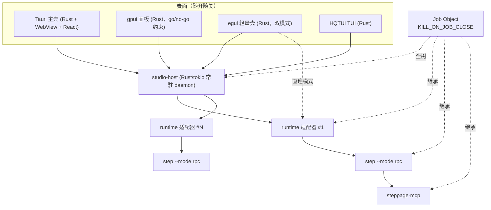
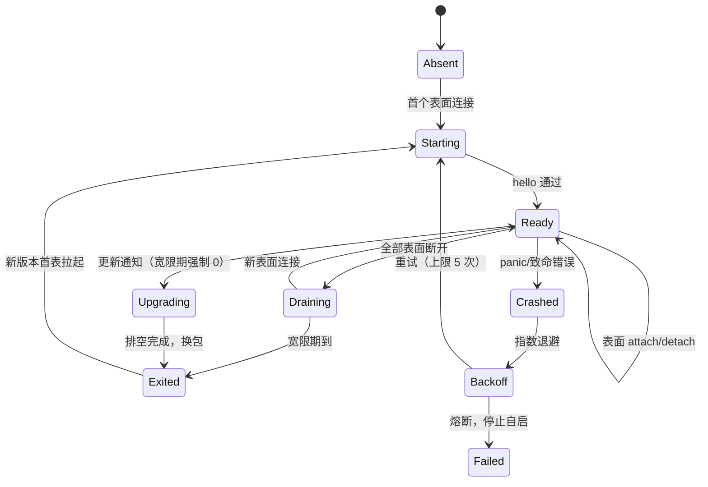
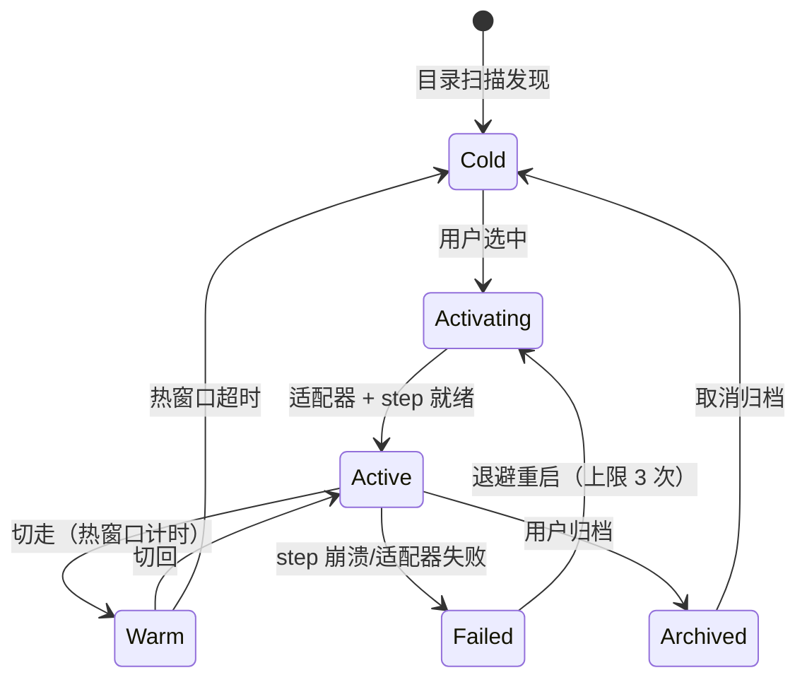
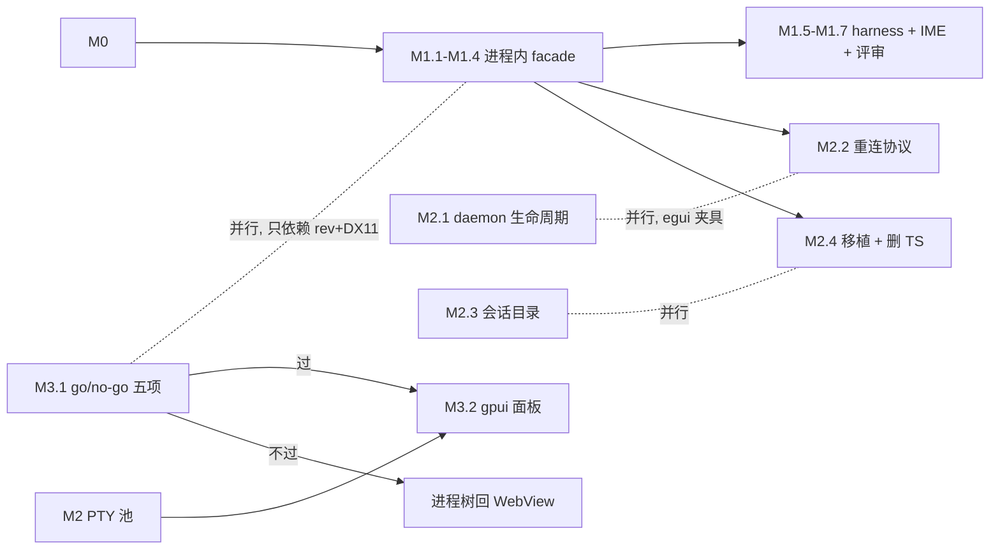

# Step Studio 设计开发方案 v5.1

> 目标：以 omp-studio 为功能与 UI 基准，用 Rust + TypeScript 重新实现其桌面形态，运行时对接 Step Code CLI，产出 Windows 优先、高性能、低开销、低占用、低存储的可视化智能体平台。
> **范围（用户 2026-11-11 确认）**：**功能与前端显示基本全复刻 omp-studio，仅把 omp 换成 step**。基准是 `docs/images/` 九张官方截图（README 第 30-86 行的功能说明段），§9.5 矩阵已逐模块对应到具体图片。版式照抄；数据来自 Step——凡 Step 拿不到的，按本节末的「数据源台账」记 unavailable 或自建，不静默留空。
> 硬约束（用户指定）：**GUI 面板与 omp-studio 像素级一致复刻**；**TUI 做到产品级**；**外壳纯 Tauri**：单个 WebView 承载全部面板（用户 2026-11-11 定，推翻此前的「Tauri + egui + gpui 混合」与「尽量减少 WebView」）。
> 基线：omp-studio 0.1.17（MIT）、Step Code（stepfun-ai/Step-Code，MIT）、本机 step CLI 随附文档与实测探针（2026-11-11）、crates.io/GitHub/npm API 取数（2026-11-11）。
> 本版相对 v5.0 的变化（M1.2a 实施）：`bootstrap` 从 stub 改为接真实 `BridgeSession`（连接适配器→取 snapshot→翻译成 `ClientBootstrap`），Xvfb 实证状态栏由「Unavailable」变「OMP Ready」。`step-studio-bridge` 加入 workspace.dependencies 与 Tauri crate 依赖。新增一条实施纪律：移植既有代码时不得把「首个匹配即返回」的循环改写成收集式迭代——本次正因此把适配器自身路径当成参数传了进去。
> 本版相对 v4.10 的变化（**外壳纯 Tauri，架构级变更**）：用户定「外壳使用纯 Tauri」，删除 egui 与 gpui 两个原生面——FR-2 由四表面收窄为二表面（Tauri + HQTUI TUI），§0 结论摘要、架构图、Rust 职责、目录树同步更新；`crates/step-studio-shell` 标记为死代码待删（其无头夹具职责已由 Xvfb + Tauri release 二进制承接，M1.1 实证）；M3 的终端/diff go/no-go 与 gpui 五项 go/no-go 全部关闭；新增两条决策记录——纯 Tauri 的理由与代价、以及内存代价改由 G-1 单独承担（失去 egui 118 MB 低开销模式兜底）。
> 本版相对 v4.9 的变化（slash 命令可经桥抵达，实测）：用户指出「桥上输 /usage 应与 CLI 输 /usage 等效」，实测成立——`/usage` 作为 prompt 发出后被按 slash 命令分发，渲染面板经 `notify` 回传（适配器已处理的 fire-and-forget 通道）。据此：用量面板的数据源从「待定路由」改为「桥上直接可用」，D-2 关闭；并新增通则——CLI 的 TUI 面板类 slash 命令大多可经 `prompt` 取到，不必等 RPC 暴露或自扫文件，代价是回传为 ANSI 文本。此前「`/usage` 不是 RPC 命令所以取不到」的判断据此作废。
> 本版相对 v4.8 的变化（Agent Hub 数据源查实后修正）：原写「Step RPC 不暴露 subagent 列表与状态」 overstated——真相是子代理会话以 `origin: "subagent"` / id 前缀存在于 `<agentDir>/sessions`，Step 在 `session-index.md` 中**有意**将其排除出所有列表与搜索，故无枚举命令；数据可达，路径为自扫会话目录（Step 自己的 `/usage` 即如此）。D-3 随之定为自建扫描、不等上游，并要求与 `/usage` 共用同一套读取与缓存。
> 本版相对 v4.7 的变化（范围确认 + 基准图台账）：用户确认「功能与前端显示基本全复刻 omp-studio，仅 omp→step」，写入目标声明；§9.5 增加「基准图」列并逐模块对应 `docs/images/` 九张官方截图；新增 §9.6 数据源台账，把九个基准面对到 Step 实际数据源，其中 Agent Hub（`hub.png`）经实测确认 Step RPC 不暴露 subagent 列表与状态，记为数据源缺失；列出的 D-1 worktree、D-2 用量路由、D-3 Agent Hub 数据源三条岔路待决策。
> 本版相对 v4.6 的变化（M1.1 实施 + 专家团三路会审）：`apps/desktop-tauri` 落地（Tauri v2 壳、bridge init script、六个 Rust 命令 stub）；`createDesktopIpcBridge` 从 `apps/desktop/src/ipc-validation.ts` 移入 `packages/transport-desktop/src/ipc-validation.ts` 并再导出（M1.2「三桥重建」种子，Electron preload 与测试改为从包导入）；§19 新增 6 条 M1.1 决策（命令名去前缀、单 listen 扇出、双参事件派发、拒绝重包、桥工厂迁移、只注入 ompStudio）；§21 进展更新。修复 `package-lock.json` 缺 `packages/runtime-stepcode` 条目导致 `npm install` 全量失败的问题。
> 本版相对 v4.5 的变化（文档归并，GAP-16）：全部 Step Studio 设计文档迁入仓库内 `design/` 单一目录（`plan.md` 研发方案 + `status.md` 实现状态 + `reference/` 参考资料 + `README.md` 索引与维护纪律）。此前方案放在仓库外，代码提交不带文档，方案与代码各自漂移；本版起 24 节规定「设计与代码同一个提交」修复该问题。内容无实质变更，仅路径引用与维护规则。
> 本版相对 v4.4 的变化（M0.4 对抗评审后修订，重要）：M0 首版实现对准了自创契约而非 Studio 真实契约，评审抓出后已修正：`interaction.respond` 的线上形状是 `{interactionId, commandId, decision: submit|cancel, value?}`（不是自创的 `response` 对象），按 method 翻译为 CLI 的 `confirmed`/`value`/`cancelled`；dialog 事件改为契约的 `interaction.required`（嵌套 request，kind 为 confirm/select/input/editor，owner/leaseGeneration），fire-and-forget 因契约里没有对应 kind 而 v1 丢弃（不再发明 `conversation.interaction.notice`）；新增 `interaction.resolved`（submitted/cancelled/aborted）并在 stale、abort、shutdown 三条路径发出；bridge 客户端新增 `send_command`（发命令不消费事件流，生产路径的应答方式）；`interaction.respond` capability 降为 limited 并写明限制；COMMANDS 表补齐既有 capability。测试全部改用契约真实形状重写。
> 本版相对 v4.3 的变化（M0 里程碑完成）：审批环在 Rust 适配器侧落地（9 个 extension_ui method + interaction.respond + INTERACTION_STALE 失败关闭）；真实 CLI 往返实证 dialog 类请求到达 RPC 客户端且应答后 turn 继续（3.3 末新增实测段）；B4 与第 8 节的 profile 隔离假设被实测推翻并修正（隔离 STEP_CODING_AGENT_DIR 会导致 models.json 不被解析、模型 2 变 0、turn 失败，故不隔离 step 自身 profile）；第 21 节进展更新。M0.3 的 Windows 冒烟因无真机阻塞，M0.4 对抗评审进行中。
> 本版相对 v4.2 的变化（两轮专家团交叉审计后修订）：5 路审计 + 3 路二审共 73 条 finding，处置台账见第 26 节。要点：M1 接法定为进程内 facade 过渡（IM-3）；终端/diff 承载默认回 WebView 并设 M3 go/no-go（AT-1 二审）；内存预算改增量式、门禁改 G-1/G-2/G-3 三结构且「应用自身 < 200 MB」降级为待判决（PV 二审）；M0 改分支式验收并砍 TS 侧重复实现（IM-1/2）；定义 30 天 MVP（IM-9）；M6 拆 M6a/M6b；新增升级迁移回滚、可访问性与本地化、许可合规三章；修正环境变量名、WBS 加总、追溯闭合等 23 处内部不一致。

---

## 0. 结论摘要

| 项 | 决策 | 一行理由 |
|---|---|---|
| 主外壳 | Tauri v2 + **单一 WebView** + React renderer 原样复用 | 像素级复刻 omp-studio 的唯一路径 |
| 终端 / diff / 文件树 / Git / 进程树 / 诊断 | **全部 WebView**（xterm.js、CodeMirror 等在库） | 纯 Tauri 定案：无原生化选项，M3 的 go/no-go 随之关闭 |
| ~~gpui 原表面板~~ | **已删除**（v5.0） | 纯 Tauri 后无第二个原生面；进程树监控改 WebView 实现，无像素级义务 |
| ~~egui 轻量壳~~ | **已删除**（v5.0） | 同上；`crates/step-studio-shell` 成为死代码待清。代价是失去 118 MB 低开销模式，G-1 成为唯一内存门禁 |
| TUI | HQTUI Rust 移植版 fork 自管，产品级 | 用户定向；TS 版需 JS 运行时或 88 MB 编译产物 |
| M1 接法 | Tauri 壳进程内 facade 直连 Rust 适配器（复现 3.4 实测路径），`HostTransport` trait 双实现，M2.4 删过渡 | studio-host 是无 bin 的库，(a) 要么嵌 JS 运行时要么新写第三条协议面；(c) 复用已验证事实 |
| Host | 常驻 daemon（Rust/tokio），壳是客户端；壳重启不杀会话 | tty7 模式 |
| 内存门禁 | G-1 壳底座（绑 N=0/S=1，前置条件 WebView2+renderer 实测 ≤165 MB）/ G-2 每面板增量 / G-3 全树（绑 N≤1/S=1） | 原「应用自身 < 200 MB」不可辩护：阈值落在 WebView2 不确定带内且未绑 N |
| 杠杆归因 | 应用自身口径第一杠杆是终端原生化（若 go/no-go 通过）；全树口径第一杠杆是惰性激活；MemoryHints 退出杠杆表降为卫生默认 | MemoryHints 对 WebView 无效；200 MB 是第三方差值禁入预算行 |
| 更新机制 | ed25519 签名清单 + 公钥 bake + daemon 热替换序列（排空→换包→重启） | daemon 常驻决定升级时旧进程必然在跑 |
| 30 天 MVP | M0 + M1.1-M1.4，dev build，明确不得对外分发 | 第一个可分发里程碑是 M5 |
| 插件沙箱 | rquickjs 单轨 + Bun 逃生舱（M6b） | deno_core 的 V8 约 21 MB 二进制不相容 |
| 规模量级 | MVP 17-29 人日；全量估算见 16.3（按 2-3 人并行给日历） | 像素签收按 9.5 矩阵逐模块估，不打折 |

---

## 1. 背景与目标

### 1.1 目标

- Windows 10/11 x64 桌面应用；主链路：登录 → 工作区 → 会话 → 流式对话 → 工具审批 → 会话恢复。
- GUI 面板与 omp-studio **像素级一致复刻**（WebView 承载面；窗口拓扑是否在像素级范围内见 19 节待签字项）。
- 二表面同一核心：Tauri 桌面壳（单 WebView 承载全部面板，像素级）、HQTUI TUI（产品级终端）。v5.0 起 egui 与 gpui 删除。
- 计算全部下沉 Rust，UI 只做纯视图投影。

### 1.2 约束演变记录

- 2026-11-11 早前：用户指令「不使用任何 WebView」，v3.0 至 v3.2 按 egui 单壳设计。
- 2026-11-11 当日：用户解除禁令，改为「Tauri + egui + gpui 混合、像素级复刻、尽量减少 WebView 使用」。
- 2026-11-11 当日晚：用户定「**外壳使用纯 Tauri**」，删除 egui 与 gpui 两个原生面，单 WebView 承载全部面板。
- 现行约束：WebView **允许但最小化**：全局单实例、只承载 React 工作台。面板移出 WebView 的判定标准（v4.3 收紧）：**先实测该面板在 WebView 内成为瓶颈，且协调原型通过 go/no-go，两个条件同时满足才迁移**。

### 1.3 非目标（v4.3）

- 多 WebView 实例（标签页/面板一律前端组件化管理）。
- 不打补丁改 Step Code 上游；cron/plan/subagents/btw/goal/ultracode 等留 v2 补丁路线（命令面权威清单见 5.3 未接项）。
- 不做 `session.openInTui` 会话交接；TUI 是独立表面。
- 不做 macOS / Linux；`platform-darwin` 弃用并同步改架构门禁表。PDEATHSIG 等 POSIX 专有机制留档不用。
- 不做远程工作区、手机连接、插件市场、delta 更新。
- 不复制 Step 会话文件到自有存储（SQLite 只放索引与用量）。
- gpui 不承担 WebView 能像素级完成的面板；egui 不承担终端面板实现。
- 机密项目纪律：不向任何外部仓库提交 PR/issue。
- i18n 非 v1 目标（v1 中文界面；英文与 RTL 后续），但高 DPI 与键盘可达是 v1 要求（见第 24 节）。
- 屏幕阅读器语义支持非 v1 目标，诚实记账（第 24 节）。
- 不追求「比 Rust 更快」式叙事：投影链路微秒级，瓶颈在等模型与进程启动。

---

## 2. 需求规格

### 2.1 功能需求

| 编号 | 需求 | 来源 |
|---|---|---|
| FR-1 | 运行时对接 Step Code CLI：复用 Studio Bridge 协议，零上游补丁，版本下限探测 | v1.0 延续 |
| FR-2 | 二表面：Tauri 主壳（单 WebView 承载全部面板，像素级）、HQTUI TUI（产品级） | 用户指定；v5.0 起由四表面收窄 |
| FR-3 | omp-studio 功能模块全量等价（矩阵见 9.5） | 用户指定 |
| FR-4 | 审批交互：9 个 `extension_ui_request` method 全处理，Full Access 二次确认，plan 提案 UI | 3.3 实测 |
| FR-5 | 会话管理：创建/恢复/树/归档/惰性激活/热进程窗口 | 3.3 实测 |
| FR-6 | 工作台能力：git（gix 读 + CLI 写）、文件树、终端、diff 审查、进程树监控、Agent 状态监控、用量 | omp-studio 等价 |
| FR-7 | 插件系统：rquickjs 沙箱 + 白名单能力 + TS 类型剥离 + Bun 逃生舱 | 预算约束推导 |
| FR-8 | MCP：rmcp client + TS server 按 stdio 托管 + 纳入进程树 | 组件选型 |
| FR-9 | TUI 四仪表盘（进程树/Agent 状态/用量/会话树）产品级，键位体系对标 tuicr | 用户指定 |
| FR-10 | 预览/演示数据模式（fixture 与真实双轨） | 继承 |
| FR-11 | 升级与回滚：v1 到 v2 的数据迁移、daemon 热替换、失败回退 | 审计 GAP-1/2 |

### 2.2 非功能需求

| 编号 | 需求 | 门禁/判据 |
|---|---|---|
| NFR-1 | 像素级复刻（WebView 承载面） | `ui_reference/` 逐页比对 + vitest 快照 + WebView2 兼容矩阵；窗口拓扑范围见 19 节待签字项 |
| NFR-2 | 低开销 | 14.7 启动门禁（只含应用自身可归因段） |
| NFR-3 | 低占用 | 14.7 三结构门禁 G-1/G-2/G-3（绑 N 与 S，G-1 带 WebView2 实测前置条件） |
| NFR-4 | 低存储 | 安装包 < 45 MB（估算上限 47.6，M5 校准）；不捆绑我方 Node 运行时；上游 step CLI 运行时含在其 167.1 MB 内 |
| NFR-5 | 崩溃安全 | Job Object 杀树零残留；panic 三件套；epoch 失效 + 未决标 `outcome_unknown`；daemon 崩溃熔断 |
| NFR-6 | 壳可重启会话存活 | daemon 常驻；杀壳不杀会话；重连全量刷新一致 |
| NFR-7 | 安全不变量 | renderer 不接触 token/进程句柄/会话文件路径（**允许工作区路径**）；帧与日志按值脱敏；DPAPI 用户级 |
| NFR-8 | 协议兼容 | TS 契约为权威源；fixture 对拍 53 kind；版本下限 + 能力探测 |
| NFR-9 | 可观测性 | tracing span；puffin 帧剖析；panic hook 崩溃日志；崩溃上报策略与诊断包（第 8 节） |
| NFR-10 | 性能可回归 | 微基准进 CI（防抖阈值）；场景基准 M1/M3/M5 建基线复测；测量配方见 14.6 |
| NFR-11 | 可访问性与高 DPI | 键盘全可达 + 焦点可见 + WCAG AA 对比度；150%/200% 两档 DPI 进像素级验收口径；屏幕阅读器语义非 v1（记账） |
| NFR-12 | 数据迁移 | v1→v2 凭据/设置/索引迁移有路径有回滚；升级不丢数据 | 第 23 节 |

### 2.3 约束

| 编号 | 约束 |
|---|---|
| C-1 | WebView 全局单实例；面板迁出需同时满足「实测瓶颈」与「协调 go/no-go 通过」 |
| C-2 | Windows 10/11 x64（版本下限 22H2，WebView2 Evergreen 最低版本，arm64 立场见 12 节支持矩阵） |
| C-3 | 机密项目：不向外部仓库提交任何 PR/issue；fork 自管第三方依赖 |
| C-4 | 会话文件格式以上游为准，host 只读不写 |
| C-5 | 已知事实与估算必须分级标注（实测/参考口径/估算/未知），禁止把估算或待确认当结论 |
| C-6 | 优化必须经测量确认；每个优化项登记预期效果与测量方法（14.3 开关表）；**先测量再破坏**（原生化收益未实测前不破坏拓扑） |

---

## 3. 事实基线

### 3.1 omp-studio 架构与规模（2026-11-11 仓库清点）

| 部分 | 语言 | 位置 | 行数（清点） |
|---|---|---|---|
| Renderer | TS | `apps/renderer` | 112,376（279 个 tsx） |
| Electron 主进程 | TS | `apps/desktop` | 21,901 |
| Host facade | TS | `packages/host-client-api` | 13,946 |
| Host 实现 | TS | `packages/studio-host` | 10,179（**无 bin 入口的库**，由 Electron 主进程进程内组合） |
| 契约 | TS | `studio-protocol` + `client-contract` | 12,552（53 个命令 kind） |
| 其余 | TS | client / installer / platform / transport / testkit / runtime-stepcode | 9,072 |

### 3.2 React renderer 的角色：产品本体

v4.0 起 renderer 是产品本体（Tauri 单 WebView 承载），等价性验收为像素级比对签收。`ui_reference/` 为比对基准。终端与 diff 面板在库（xterm.js + diff 组件），默认承载回 WebView 后它们是还原而非新写（AT-1 二审）。

### 3.3 Step Code 运行时事实（2026-11-11，来源：本机 `~/.stepcode/bin/docs/` 随附文档 + 实测探针）

**会话模型（实测确认）：一个 `step --mode rpc` 进程同时只有一个活动会话。** `get_state` 只返回一个 `sessionFile` + `sessionId`；实测两次 `new_session` 得到不同 id，是替换不是新增；`prompt`/`steer`/`follow_up`/`abort`/`get_entries`/`fork`/`clone` 均无 session 参数。**推论：N 个并发会话 = N 个 `step` 进程**，上游约束不可合并。

**会话文件**：`~/.stepcode/agent/sessions/<encoded-cwd>/<timestamp>_<uuid>.jsonl` 多文件、懒创建；首行 session header `{"type":"session","version":3,…}`；条目类型含 `session`/`message`/`model_change`/`thinking_level_change`/`compaction`/`branch_summary`/`custom`/`custom_message`/`label`/`session_info`；`custom` 占比极高（实测一条真实会话 31 行里 27 行是遥测），host 直读必须过滤；append-only 可并发读；`get_entries {since?}` 的 `since` 是跨重启持久游标。

**审批面**：`extension_ui_request` 共 9 个 method，dialog 类 `select`/`confirm`/`input`/`editor`（阻塞，按 `id` 回 `extension_ui_response`），fire-and-forget 类 `notify`/`setStatus`/`setWidget`/`setTitle`/`set_editor_text`。**超时由上游 agent 端自动 resolve 为默认值**（`select`→`undefined`，`confirm`→`false`），客户端无计时职责。**Step 核心没有内置权限弹窗**，审批来自扩展；实测启动只见到 `setStatus`，dialog 类是否到达 RPC 客户端需构造触发实测（M0）。`--plan-review-surface` 让 `exit_plan_mode` 保持 plan mode 并由客户端画提案。

**模型与 thinking**：`models.json` 为 providers 结构；thinking 共 7 档，`get_available_thinking_levels` 驱动 UI 可选集。

**认证优先级**：① CLI `--api-key` ② `auth.json` ③ 环境变量（含 `STEP_API_KEY`）④ `models.json` 自定义 provider keys。**`STEP_API_KEY` 排第三，登录用户会被静默忽略**。OAuth 只有交互式 `/login`，无 headless 登录命令。

**环境变量（2026-11-11 本地文档核实，修正 v4.2 错误命名）**：agent 目录隔离用 `STEP_CODING_AGENT_DIR`（默认 `~/.stepcode/agent`）；会话存储隔离用 `STEP_CODING_AGENT_SESSION_DIR`（`--session-dir` 优先）。**`STEPCODE_CONFIG_DIR` 不存在**（v4.2 B4 误写，已改）。另有 `STEPCODE_CONFIG_PATH`、`STEPCODE_DISABLE_TELEMETRY`（遥测开关，第 8 节采用）、`STEPCODE_SUBAGENT_CHILD` 等。`STEPCODE_AUTH_PATH` 存在性未核实（22 节）。

**统计**：`get_session_stats` 返回 tokens/cost/contextUsage 与消息计数；**无耗时字段**，usage 面板耗时客户端自计。

**审批环实测（2026-11-11 M0，真实 CLI 往返）**：dialog 类 `extension_ui_request`（`confirm`，带 id/title/message）**确实到达 RPC 客户端 stdout**；客户端回 `extension_ui_response`（同 id + `confirmed`）后 turn 继续并 settle，扩展的后置 notify 证明 CLI 收到了答复。触发条件：扩展放全局 `~/.stepcode/agent/extensions/`，`agent_start` 事件触发（`turn_start` 不触发）；**项目级 `.stepcode/extensions/` 在非交互模式不加载**（信任门）。

**其他**：`bash` 无上游沙箱；前台 `run_command` 默认 120s 超时、输出上限 50KiB/2000 行；RPC `bash` 输出在**下一次 prompt** 才进上下文；`--include-live-events` 才有 `message_update`/`tool_execution_update`（后者上限 256KiB）；**`entry_appended` 事件实测稳定出现但文档未收录**，用作会话目录增量同步信号；Windows shell 解析 Git Bash 优先、不自动选 WSL；帧格式严格 JSONL；Smallstep 的 `step` 重名靠安装目录与 `--version` 识别；CLI 透传环境变量给 shell 命令，**所有帧和日志按值脱敏**；遥测默认开启（`~/.stepcode/config.toml` 或 `STEPCODE_DISABLE_TELEMETRY` 可关）；官方二进制只走 CDN，可审计需源码构建（Node ≥ 22.19）。

### 3.4 本仓实测数字（status.md，Linux release，step 0.1.7）

| 项 | 数值 | 口径 |
|---|---|---|
| egui 壳 | 118.0 MB | Linux Xvfb + Mesa 软栅；疑含 `MemoryHints::Performance` 预分配；无 WebView 无 daemon |
| Rust 适配器 | 2.8 MB | 对比 Node 适配器 64.4 MB：**相对适配器省 96%（61.6 MB），占含 Node 适配器的假想全树 434.4 MB 的 14.2%**（v4.2 的「14%」分母未注明，已补） |
| step CLI | 167.1 MB | 上游固定；**每并发会话一份** |
| steppage-mcp | 84.9 MB | 仅 MCP 活动时存在；随 step 退出而释放 |
| 链路合计 | 372.8 MB | 单会话聊天子集（egui 壳直连适配器，无 host、无 WebView） |
| release 二进制 | 16 MB | egui 壳磁盘体积 |
| 冷启动到首快照 | 3.4 秒 | 绝大部分是 step 启动；壳进程→窗口段未分离 |
| 回合 CPU | 5.7 秒回合内全树 0.2 秒（单核 3%） | 瓶颈在等模型 |

### 3.5 参考资料口径（非本仓实测，仅作量级参照）

Electron 安装包 100 MB 以上；Tauri 单窗口空闲 20 至 80 MB、6 窗口约 170 MB；**重 React 工作台（本项目属此类）空闲 RSS 120 至 200 MB**（对照 Electron 250 至 500 MB）；WebView2 冷启动额外 2 至 3 秒（tauri#10822）；xterm.js 每面板 30 至 50 MB、按键延迟 15 至 30 ms，原生 Rust 终端 2 至 5 MB、1 至 2 ms；egui issue #8453（第三方应用 Windows 同配置 MemoryHints 差约 200 MB）。正式宣称以 M5 实测为准。

---

## 4. 总体架构

### 4.1 四表面同一核心

```
                 ┌────────────────────────────┐
                 │  studio-host (Rust 常驻 daemon) │
                 │  会话目录/workspace/models/usage/  │
                 │  skills/git/诊断/PTY 池/插件沙箱   │
                 └───────┬────────────────────┘
                         │ Studio Bridge（HMAC 帧）
        ┌────────────────┼────────────────┬──────────────┐
        │                │                │              │
  Tauri 主壳        gpui 原表面板      egui 轻量壳     HQTUI TUI
  (单 WebView       (候选：进程树      (纯对话/       (产品级
   + React 像素级)    监控，go/no-go)     无头夹具)       终端仪表盘)
```

所有表面都是 host daemon 的客户端。两个例外：

- **例外一（常态）**：egui 轻量壳双模式（C-E），纯对话模式直连适配器，复现 3.4 实测路径。
- **例外二（过渡形态，M2.4 删除）**：M1 期间 Tauri 主壳以进程内 facade 直连 Rust 适配器（复用 3.4 实测路径与 `crates/studio-bridge` 已支持的「spawn 适配器」模式）；daemon 就绪后改为经 daemon。过渡期内两种后端由壳侧 `HostTransport` trait 共存（`InProcessFacade` / `DaemonClient` 两实现），CI 双后端回归，切换成本 3-5 人日含在 M2.2。

### 4.2 语言职责

| 语言 | 承担 | 不承担 |
|---|---|---|
| Rust | host daemon、桥、适配器、Tauri 壳、平台原语、插件沙箱宿主 | 无 |
| TypeScript | React renderer（WebView 内）、HQTUI 上游参考、插件脚本、上游 step CLI、开发工具链 | host 运行时 |

### 4.3 进程模型



- daemon 生命周期：首个表面连接时拉起，之后常驻；全部表面断开后宽限期（初定 10 分钟）退出；**升级场景宽限期强制为 0**（见 12.4）。
- **窗口生命周期（v4.3 新增，GAP-3）**：Tauri 主壳是窗口树的根；gpui 子窗（若存在）owner 为主窗，主窗最小化时子窗跟随最小化、主窗关闭时子窗关闭（不等宽限期）；杀壳重连时子窗先消失，重连成功后按保存布局恢复。第二个 Tauri 实例被单实例锁拦下时唤醒已有窗口并转发参数（打开工作区/会话）。
- 会话激活：活跃会话持有 step 进程；切后台热窗口（初定 60 秒）后退出；会话状态以磁盘文件为准。
- daemon 持 Job Object 全树杀（只设 `KILL_ON_JOB_CLOSE`）；目标 Win10+。
- panic 三件套 + **daemon 监督者带指数退避与熔断**：连续失败 N 次（初定 5 次）停止自启并留痕，表面显示「守护进程无法启动」终态与手动重试入口，不无限重启刷屏（AT-11）。
- 重连协议终态（AT-12）：3 次失败后进入 giving-up 态，UI 给出一键重试；不无限转圈。
- 所有 Windows 子进程统一 `creation_flags(0x08000000)`（CREATE_NO_WINDOW）。

### 4.4 目标目录结构（v4.3）

```
step-studio/
├── Cargo.toml                    # Rust workspace（edition 2021，rust-version 1.85）
├── crates/
│   ├── studio-bridge/            # 帧协议 + HMAC + UDS/命名管道 + host 客户端（在用）
│   ├── step-studio-runtime/      # Step CLI 适配器（在用）
│   ├── step-studio-shell/        # 【死代码，v5.0 待删】原 egui 轻量壳；无头夹具职责已由 Xvfb + Tauri release 二进制承接（M1.1 实证）
│   ├── studio-host/              # 常驻 daemon：服务层 + 会话多路复用（M2 起）
│   ├── studio-native-panels/     # 【已取消，v5.0】gpui 面板；进程树监控改 WebView 实现
│   └── hqtui/                    # HQTUI fork 的唯一实体位置（vendored path，M6）
├── apps/
│   ├── renderer/                 # React renderer，产品本体（M1 Tauri 化）
│   └── desktop-tauri/            # Tauri v2 主壳（M1 新建；替代 apps/desktop）
├── packages/                     # TS 契约与工具（host 侧随绞杀退役）
├── packaging/                    # NSIS 资产（复用）
└── scripts/                      # 门禁、fixture 导出、架构约束、基准脚本
```

删除计划：`apps/desktop`（M5 后，4-6 人日）、`packages/platform-darwin` 与 `transport-web`（M7）、host 侧 TS 模块随绞杀逐块删。

### 4.5 信任边界总表

| # | 边界 | 跨越物 | 允许 | 禁止 |
|---|---|---|---|---|
| B1 | renderer ↔ Tauri 壳 | Tauri IPC（JSON） | 命令/查询/订阅；投影数据；**工作区路径** | token、进程句柄、会话文件路径、bridge token |
| B2 | Tauri 壳 ↔ daemon | 二进制 channel | 命令/查询/事件 | 凭据、环境变量原样透传 |
| B3 | daemon ↔ adapter | Studio Bridge 帧 | token-file 握手后的会话帧 | token 进日志、进 WebView |
| B4 | adapter ↔ step | 环境变量 + stdio | 用户自己的 `~/.stepcode` profile（**不隔离**，实测见 3.3 末） | 继承的**其他** provider 凭据（如 `ANTHROPIC_API_KEY`）泄漏进 step 子进程 |
| B5 | daemon ↔ 插件沙箱 | rquickjs 白名单函数 | 显式授予的能力 | 默认 fs/net、进程、环境读取 |
| B6 | 任意 ↔ 日志 | 日志出口 | 键名 + 长度 + 类型 | 按值的 key/token/路径 |

### 4.6 crate 依赖规则（CI 强制）

| 规则 | 内容 |
|---|---|
| C-B | `studio-bridge`（含 host 客户端）零内部依赖 |
| C-R | `step-studio-runtime` 仅依赖 `studio-bridge` |
| C-H | `studio-host` 依赖 `studio-bridge`；不得依赖任何壳 crate |
| C-E | `step-studio-shell` 仅依赖 `studio-bridge`；双模式；不得依赖 `studio-host` 内部模块 |
| C-G | `studio-native-panels` 依赖 `studio-bridge` 与 host 客户端；不得依赖 egui/tauri |
| C-T | `apps/desktop-tauri` 是唯一可依赖 `tauri` 的 crate |
| C-Q | `hqtui` fork 保持零依赖；变更必须过 13 组 golden fixtures |
| 门禁 | cargo-deny + 自研依赖规则测试；破规则同一次提交改表和代码 |

---

## 5. 接口契约

### 5.0 帧协议字节级规格

```
帧 = [4 字节大端长度 N][1 字节类型][N-1 字节 payload]
类型：0x01 hello / 0x02 command / 0x03 query / 0x04 event / 0x05 receipt / 0x06 close
hello：协议版本(u16) + 角色(u8) + challenge(32B) + HMAC-SHA256 proof(32B)
command/query：id(u64) + kind(u16) + payload
event：seq(u64) + stateVersion(u64) + kind(u16) + payload
receipt：id(u64) + grade(u8) + payload
grade（receipt 专用）：0=accepted 1=completed 2=rejected 3=failed 4=outcome_unknown
close：reason(u16)
约束：单帧上限 8 MiB（与上游 StepFrame 一致）；hello 未通过前拒收一切业务帧
payload 编解码（v4.3 补，AT-14）：JSON（serde_json）为默认；热路径大对象（PTY 字节流、长文本增量）走 raw 字节段，禁止逐条 JSON 序列化；超过 8 MiB 的对象（大 diff、完整转录）改走「引用 + 分页拉取」，不进帧
capability 等级（v4.3 改名以示区分）：stable / limited / unavailable，字段名改 support 或 level，不复用 grade
```

历史教训：小端 + 只含 body 的长度 + 两键头曾对着 mock 全过、对着真实适配器失败；大端、五键头、HMAC challenge proof 与 payload 编解码规则同为字节级契约，改任何一项双实现对拍。

### 5.1 daemon ↔ surface 契约

- 传输：本地二进制 channel（命名管道/UDS），帧格式同 5.0；握手复用 HMAC challenge proof。
- 表面启动：connect → hello（协议版本、表面类型、能力集）→ ready；**daemon 拒绝版本过低表面并给出最低版本号；hello 带 daemon 构建号，供升级 skew 判定（12.4）**。
- 三类消息：`command`（有回执）、`query`（有响应）、`event`（广播，带 `eventSeq` 与 `stateVersion`）。
- 热路径合帧：daemon 侧 16 ms 环形缓冲，同 topic 丢旧保新；必达流（turn 文本）用有界 channel + `try_send` 失败即累加。
- 重连协议（对应 6.4）：断开 → 指数退避重连（上限 3 次）→ hello 带本地 `stateVersion` → stale 则全量刷新 → 3 次仍失败进 giving-up 态 + 一键重试（AT-12）。
- 表面断开不终止任何会话；宽限期内无表面则排空退出。

### 5.2 renderer ↔ Tauri 壳契约

- 5 方法（`bootstrap/query/command/subscribe/close`），`transport-desktop` 传输实现一行不改；6 个 channel 字符串变 `#[tauri::command]` 名；`initialization_script` 包 `invoke`/`listen` 挂 `window.ompStudio` 并 `Object.freeze`。
- 三座桥：`ompStudioChrome`（`IpcRendererLike` + `WebUtilsLike` 抽象已就绪）、`ompStudioTerminal`（PTY 状态通道，数据面走 daemon→壳→WebView 二进制帧）、`ompStudioRemote`（SSH，v4 留桩）。

### 5.3 daemon ↔ adapter 命令映射

（表同 v4.2：19 条 Studio kind → Step RPC 映射，Step 侧事实以 3.3 为准；`turn.retry` 语义近似、`session.tree.navigate` 切回一致性待确认。）

未接命令与优先级见 11.4。v1.1/v2 再补：`mode.plan.*`、`goal.*`、`btw.*`、`session.prewalk.*`、`omfg.*`、`vibe.*`、`operator.*`、`tan.start`、`tui.transfer`（后六项标 unavailable）。

### 5.4 事件映射

（表同 v4.2：message/tool/turn/interaction/context/`entry_appended`→`session.catalog.changed`/exit/unknown→raw。）

### 5.5 插件 API 契约（M6b）

白名单能力面；schemars 导出 JSON Schema（Rust 为唯一真源）；rquickjs 引擎级 memory limit + interrupt handler 熔断；oxc/swc 安装期剥离 TS；Bun 逃生舱按需下载、**固定版本 + ed25519 签名清单内或随包**（AT-13：不得裸下载执行）。

### 5.6 TUI 数据面（M6a）

四仪表盘共用 daemon query 面；键位对标 tuicr；帧率 30（SSH 降 15）。

### 5.7 并发模型规格（daemon）

- task topology：1 个 tokio runtime；每适配器连接 1 task；**每 PTY 2 个专用线程（或 `spawn_blocking`），不用 tokio task 跑阻塞读**（IC-13）；文件监听 1 task + debounce；广播 1 bus task；每表面 1 连接 task。
- channel 选型：命令/查询 oneshot；内部投递有界 mpsc；广播 `broadcast`（lagged 丢旧保新）；必达流有界 mpsc + `try_send` 累加。
- 背压策略：turn 文本必达累加；工具 delta 丢旧保新；PTY 16 ms 合帧；git status/文件树丢旧保新 + debounce；审批请求必达。
- `spawn_blocking` 只给偶发重活（大文件读取、首次索引）。

---

## 6. 状态机

### 6.1 daemon 生命周期



### 6.2 会话生命周期



### 6.3 turn 与审批

turn：`idle → streaming → (awaiting_approval) → settling → settled`（completed/failed，附 CLI 原始错误；桥接线程消失立即 failed）。审批：`requested → responded` ｜ `auto_resolved`（上游超时）｜ `stale`（回 `INTERACTION_STALE`）。epoch：运行时丢失则自增，旧 epoch 未决标 `outcome_unknown`。

### 6.4 表面重连

`connected → disconnected → reconnecting（指数退避，上限 3 次）→ hello 比对 stateVersion →（stale）full_refresh → connected`；3 次失败进 giving-up + 一键重试。重连后全量刷新，不沿用陈旧状态。

---

## 7. 错误处理体系

### 7.1 错误码与处理策略

（表同 v4.2：十类错误码及策略，`UNKNOWN_MUTATION` 失败关闭。）

### 7.2 文案与日志纪律

- 用户可见错误三要素：发生了什么、影响、怎么恢复。
- 日志：结构化（tracing）+ 按值脱敏；stderr 上限 40 行 + 正则过滤。
- **日志落盘（v4.3 补，GAP-12）**：`%LOCALAPPDATA%\Step Studio\logs\`；daemon 与各表面各写一个文件（`daemon-YYYY-MM-DD.log` 等）；单文件上限 10 MB、总量上限 200 MB，超限轮转（保留 7 天）；崩溃日志单独目录不轮转。
- receipt 五态语义不变。

---

## 8. 安全模型

- B1 至 B6 按 4.5 执行；Tauri ACL 不视为安全边界，不变量全在 daemon facade。
- bridge token 只在 daemon 内，经 token-file 注入子进程。
- 凭据只在 daemon，DPAPI 用户级（不设 `CRYPTPROTECT_LOCAL_MACHINE`），原子 rename，卸载默认保留。
- 子进程环境隔离（2026-11-11 M0 实测修正）：**不隔离 step 自身 profile**。实测 `STEP_CODING_AGENT_DIR` 指向空目录时 models.json 不被解析，模型列表 2 个变 0 个、turn 直接失败（No API key found）。隔离语义收窄为：剥离继承的**其他** provider 凭据（如 `ANTHROPIC_API_KEY`），step 用用户自己的 `~/.stepcode`。
- 认证优先级如实处理（`auth.json` 高于 `STEP_API_KEY`）；登录引导开一次 TUI 或自建 OAuth。
- 按值脱敏（CLI 透传 env 给 shell 命令）。
- **崩溃上报策略（v4.3 补，GAP-7）**：v1 **不上报**，只本地落盘；用户可一键导出诊断包（版本 + 日志 + 环境信息，**明确排除凭据、会话正文、工作区文件内容**）；将来若启上报：opt-in、字段白名单（版本/OS/GPU/后端/错误码/堆栈）、无会话正文无路径无 token、保留期 90 天。理由：崩溃转储是最易泄漏用户代码与凭据的通道，v1 不做。
- **遥测（v4.3 补）**：本端不收集；提示用户上游遥测默认开启，关法：`~/.stepcode/config.toml` 或 `STEPCODE_DISABLE_TELEMETRY`（本地文档已核实存在）。
- bash 无上游沙箱，审批 UI 是权限控制主界面；插件沙箱白名单默认拒绝。
- 更新：ed25519 清单 + 公钥 bake + 版本签入防降级；Bun 逃生舱固定版本 + 签名（AT-13）。
- **隐私清单（v4.3 补，GAP-11）**：本端留存物仅三样：DPAPI 凭据（用户级）、SQLite 索引与用量（本地）、日志（本地，按值脱敏）；无云端账号、无行为上报。

---

## 9. UI 层：四表面分工

### 9.1 表面 A：Tauri 主壳（单 WebView，像素级）

- 构成：Tauri v2 + WebView2 + React renderer 原样；像素级来源是同一份代码与 CSS，差异只剩 WebView2 与 Electron 内嵌 Chromium 的版本差（M1 建兼容矩阵）。
- IPC 迁移、三座桥、窗口铬（`decorations(false)` + `titleBarStyle: Overlay` + 几何重校）、预览模式零改动：见 5.2。
- 验收：`ui_reference/` 逐页并排比对 + vitest 快照 + 兼容矩阵；**高 DPI 150%/200% 两档进比对口径**（NFR-11）。
- **终端与 diff 面板默认在本表面**（AT-1 二审）：xterm.js（WebGL 渲染器）与 diff 组件已在库，数据面改走 daemon→壳→WebView 二进制帧；「xterm 相关面板因终端原生化而移除」一句废止。

### 9.2 表面 B：gpui 原表面板（**已取消，v5.0**）

> 纯 Tauri 定案后本表面删除。进程树监控改由 WebView 实现（htop 式 canvas/SVG，无像素级义务），原 go/no-go 五项与降级梯作废。以下内容仅作历史留存。

- 范围收缩：**唯一候选是进程树监控面板**（htop 式新形态，omp-studio 无 dock 像素级义务）；终端与 diff 的迁移权收回到 9.1 默认，除非 9.6 go/no-go 五项全过。
- 构成（若过）：gpui + gpui-component + `NativePanel` trait；独立无边框 owner 窗，主窗最小化/关闭时跟随（4.3 窗口生命周期）。
- 依赖风险：锁 git rev；**gpui Windows 后端 `WindowKind::Floating` 目前是空操作，Zed PR #63277（2026-08-27 开，未合）补的正是 WS_POPUPWINDOW + parent_hwnd**。若选独立窗形态，要么自带 patch（fork 维护税 +1）要么等合入；进程树面板若无浮空需求可避开。
- 降级梯（AT-6 二审）：L1 go/no-go 不过 → 进程树监控也回 WebView（htop 式用 canvas/SVG 实现，renderer 内新增，估 3-5 人日），gpui 线整体关闭；L2 gpui 全败（rev 构建不过/trait 覆盖不了）→ 原生的线推迟至 M5 后重评。**egui 终端面板不再作为退路选项**（16-24 人日成本黑洞，且 egui 三角色不含此）。

### 9.3 表面 C：egui 轻量壳（双模式 + 无头夹具 + 退路）

- 三角色：纯对话低开销模式（直连适配器）；无显示环境的 host 协议 E2E 夹具（25 个 cargo 测试）；gpui 整体失效时的面板退路（**不含终端面板实现**）。
- 配置：`MemoryHints::MemoryUsage` 为卫生默认（第三方同配置差值约 200 MB 仅作存在性证据，禁入预算行）；GPU 降级链 DX12→Vulkan→GL + `gpu.json`；托盘跳帧；自建内存 GC 插件。
- 版本：M1 评估升 0.32/0.33；0.34+ 需 MSRV 1.92，显式决策点排在中文输入法验收前。

### 9.4 表面 D：HQTUI TUI（产品级）

- 选型：`ports/rust` crate `hqtui` 0.2.0（约 1.82 万行零依赖）fork 自管 + vendored path；TS 包需 Bun/Node 或 88 MB 编译产物，不采用。
- 能力面：真彩色 + 自动降级；Braille 2×4 像素/格 + block/ASCII 模式 + 渐变 + alpha；CSS Grid 风格约束布局；约 30 组件；30fps（SSH 降 15）+ 差分渲染；SGR 鼠标 + Tab 焦点 + OSC 52；headless 渲染器**待 M6a.1 spike 确认**（v4.2 误列为既有能力，IC-9 已改）；13 组 golden fixtures 作对拍门禁。
- 形态：进程树监控 + Agent 状态监控 + 用量 + 会话树四仪表盘，键位对标 tuicr。
- 风险：0.2.0、无生产先例、单人维护、未上 crates.io；fork 终身维护估 1-2 人日/月（C-3 禁上游 PR）；失败退 ratatui 0.30.2（MSRV 1.88 已记）。

### 9.5 功能模块等价矩阵（按承载面分）

| 模块 | 参照（React） | 基准图（`docs/images/`） | v4.3 形态 | 承载面 | 期次 |
|---|---|---|---|---|---|
| 工作台壳 / 窗口铬 | renderer 外壳 | `workbench.png` | 原样 + 几何重校 | WebView | M1 |
| 首页 / 工作区选择 | HomePage | `home.png` | 原样（worktree 项目列表见下） | WebView | M1 |
| 对话流（正文/思考/工具卡） | 对话页 | 无对应图 | 原样 | WebView | M1 |
| Composer | Composer 系列 | 无对应图 | 原样 | WebView | M1 |
| 审批交互 | interaction 卡片 | 无对应图 | 原样（9 method） | WebView | M0/M1 |
| 模型选择 / thinking 档位 | 模型页 | `models.png` `roles.png` | 原样；供应商仅 Step 一家、角色数以 Step 实测为准 | WebView | M1 |
| 会话管理 | 会话页 | 无对应图 | 原样 + daemon 惰性激活 | WebView | M2 |
| Agent Hub / Skills / MCP / 设置 | 对应页面 | `hub.png` `capabilities.png` `skills.png` | 原样；Agent Hub 数据源见下 | WebView | M4 |
| 用量面板 | 用量页 | `telemetry.png` `home.png` | 原样（耗时自计；Step `/usage` 已有 token/成本/缓存/子代理归属/余额百分比） | WebView | M4 |
| Git / GitHub 面板 | Git 面板 | `git.png` | 原样（gix 读 + CLI 写） | WebView | M3 |
| 工作区文件树 | 文件树 | 无对应图 | 原样（ignore 遍历） | WebView | M3 |
| 终端 | xterm.js + node-pty | 无对应图 | **原样（WebView，AT-1 二审默认）** | WebView | M1/M3 |
| diff 审查 | diff 面板 | 无对应图 | **原样（WebView，AT-1 二审默认）** | WebView | M3 |
| 进程树监控 | 诊断页 | 无对应图 | go/no-go：gpui 原生或 WebView 实现 + TUI 双呈现 | gpui 或 WebView + TUI | M3/M4 |
| Agent 状态监控 | 工具卡 + 诊断 | 无对应图 | WebView 卡片 + TUI 仪表盘 | WebView + TUI | M4 |
| 诊断 / 日志 | 诊断页 | 无对应图 | 原样 | WebView | M4 |
| 预览模式 | preview fixtures | 无对应图 | 原样 | WebView | M4 |
| 托盘 / 菜单 / 单实例 | tray/app-menu | 无对应图 | Tauri 插件 + 自研权威锁 | Tauri 壳 | M5 |
| 轻量对话模式 | 无（新增） | 无对应图 | 纯对话最低内存壳 | egui | M5 |
| 终端仪表盘 | 无（新增） | 无对应图 | 产品级 TUI | HQTUI | M6a |

像素签收按本矩阵逐模块估（约 1-2 人日/模块，19 个 WebView 模块合计估 20-38 人日，摊到 M1 至 M4），替代原打包估算（IM-4）。

### 9.6 九张基准图的数据源台账（v4.8 新增）

按用户 2026-11-11 的范围要求（功能与前端显示基本全复刻，仅 omp→step），把九个基准面逐一对到 Step 的实际数据源。**版式一律照抄；此表只记数据从哪来、缺多少。**

| 基准面 | 图 | 数据源状态 | 差距与处置 |
|---|---|---|---|
| 工作台欢迎页 | `workbench.png` | 齐 | 无 |
| 首页项目列表 | `home.png` | **部分** | 项目卡是 worktree 感知的（路径在 `worktrees/` 下）；本方案现行接法把适配器钉在单 repo 根目录（见 `status.md` 续接节）。冲突未解，见决策 D-1 |
| Skills 侧栏 | `skills.png` | **部分** | 项目 / 全局 / 内置三分组的填充来源未定；Step 侧已声明 `session.extensions.list`、`session.commands.list`，但分组口径要实测 |
| 对话顶栏用量 | `telemetry.png` | **齐，桥上直接可用** | 实测（2026-11-11）：把 `/usage` 当普通 prompt 从桥上发过去，CLI 按 slash 命令分发（`extensionPath: "command:usage"`），渲染好的面板经 `extension_ui_request` 的 `notify` 方法回来——走的正是适配器已处理的 fire-and-forget 通道。返回内容是 ANSI 渲染文本（热力图 + Activity insights：总 chats、活跃天、总 token、常用 reasoning、技能发现/使用数）。结构化数字另可从 `get_session_stats` 取；TPS 需自算。**不需要自扫会话文件，也不必等上游** |
| 供应商管理 | `models.png` | **大幅缩减** | Step 单供应商；上游的多供应商列表、开关、端点、`modelProviderOrder` 大部分空置。版式保留，内容按 Step 实况 |
| 角色配置 | `roles.png` | 缩减 | 「角色 × 模型 × thinking 档位」结构在；实测 Step 仅 2 个模型（上游 11 角色 × 多模型） |
| 能力中心 | `capabilities.png` | 基本齐 | 三个 list 命令已声明为 stable |
| Agent Hub | `hub.png` | 可达但需自建 | 子代理会话真实存在：`<agentDir>/sessions` 下的独立 session 文件，header 带 `origin: "subagent"` 或 id 前缀 `subagent-`/`workflow-`（`isChildAgentSession`）。Step **故意**把它们从所有列表与搜索中排除（`session-index.md`），所以 40 余个 RPC 命令里没有枚举命令——`get_state` 无 children 字段，`get_tree` 是单会话内的消息树。数据可达，路径是自扫会话目录（Step 自己的 `/usage` Overview 就这么统计子代理 token 归属）。见决策 D-3 |
| Git 面板 | `git.png` | 齐（自建） | gix 读 + CLI 写，M3 已排 |

**三条待决策岔路**（都不阻塞 M1.1-M1.4 的脚手架与挂载，但分别在 M1 首页、M4 用量、M4 Agent Hub 动工前必须定）：

- **D-1 worktree（2026-11-12 实测定案）**：判据是「Step 的 session 存储键是否为 project 绝对路径」——**是**。`~/.stepcode/agent/sessions/` 下每个项目一个目录，目录名是 project 绝对路径把 `/` 换成 `-`（如 `--home-ubuntu-workspace-step-studio--`），session 文件内还带 `cwd` 字段。即**每个 worktree（不同绝对路径）天然落到各自的 session 存储**，`--continue` 按 project 各自恢复。定案：**每个 worktree 作为独立 project 传给适配器**，不需要 Step 有 worktree 概念；首页的项目列表因此可以是多 project，不与适配器冲突。
- **D-2 用量面板路由（已实测解决）**：把 `/usage` 当 prompt 从桥上发过去即得整块面板（`notify` 回来，ANSI 文本）。不等上游、不自扫文件。遗留一个呈现层选择：直接显示 ANSI 文本面板，还是解析出结构化数字后按 `home.png`/`telemetry.png` 的图表重绘——前者零成本但不像素级，后者要写 ANSI 解析。建议前者先落地、后者按需。**注意保持 stdin 不关**，否则活动扫描被取消，只收到 `extension_error`。
- **通则（2026-11-11 实测）**：**slash 命令可经 `prompt` 抵达**。`rpc.md` 只承诺「extension command 立即执行」，实测内置命令同样被分发（`/usage` → `command:usage`），渲染结果经 `notify` 回传。这意味着 CLI 的 TUI 面板类命令（`/usage`、`/status`、`/models`、`/skills` 等）大多可从桥上直接取到，不必等 RPC 暴露，也不必自己复刻其数据来源。代价是回传为 ANSI 文本而非结构化数据。适配器需保证：发这类 prompt 时不占用会话轮次、且进程 stdin 常开。
- **D-3 Agent Hub 数据源**：已查实——子代理会话在 `<agentDir>/sessions` 下以 `origin: "subagent"` 或 id 前缀标识，Step 有意将其排除出列表与搜索，故无 RPC 枚举。取自建扫描（读 session 目录 + 识别子代理标记 + `get_session_stats` 取每会话数字），不等上游。扫描时注意：这些文件同时是 `/usage` 的数据源，两边要共用同一套读取与缓存，不要各写一份。

### 9.6 M3 go/no-go 判据（AT-1 二审，五项全过才原生化）

1. **窗口协调原型**：主窗移动/跨屏/per-monitor DPI 变化/最小化/alt-tab/任务栏/杀壳重连七场景，任一子窗脱根或错位 → no-go；
2. **WebView 终端实测**：xterm.js（WebGL）+ 长输出 soak 帧时直方图与面板 RSS；若最长帧 < 16 ms 且增量 < 25 MB，原生化收益前提消失，定案 WebView；
3. **diff 大 diff 滚动 CPU 实测**（similar 收益在 CPU 侧）；
4. **gpui rev Windows DX11 可构建** + `NativePanel` trait 覆盖 + gpui-terminal 跑真实 shell；
5. **收益前提**：G-1 前置条件（WebView2+renderer 实测 ≤ 165 MB）已回填，且终端面板实测增量确认超 25 MB。

默认结论从「原生」翻转为「**回 WebView，除非五项全过**」。进程树监控作为独立候选单独过 1/4/5 三项（无像素级义务，但协调成本相同需单独收益论证）。

### 9.7 可访问性与本地化（v4.3 新增，GAP-5/6）

- 键盘：全部交互可 Tab 到达、Enter/Space 激活、Escape 关对话框；焦点指示可见；renderer 侧既有实现需逐页核对（对照 omp-studio 行为）。
- 对比度：WCAG AA（正文 4.5:1、大字 3:1），三表面各自口径；TUI 的 16/256 色降级路径一并验。
- 高 DPI：150%/200% 两档进像素级验收；gpui 子窗（若存在）per-monitor DPI 各自处理 WM_DPICHANGED。
- IME：中文输入法最早测（三表面各自路径：WebView 随 WebView2、egui 0.31 已知弱项、gpui 自兜）。
- 诚实记账：屏幕阅读器语义（AccessKit/UI Automation）**非 v1 目标**；像素级复刻会连带继承 omp-studio 既有的 a11y 缺陷，v1 只承诺「不新增缺陷 + 键盘可达 + 对比度」。
- i18n：v1 中文界面；英文与 RTL 非目标（后续）；OMP 遗留的 i18n 资源文件随 renderer 复用，不新增语言。

---

## 10. Host 层：daemon 化

### 10.1 判决与理由

（同 v4.2：tty7 模式 + goal/cron 保活需求；daemon 捆绑 Node 不可接受。）

### 10.2 绞杀顺序（v4.3 补插件沙箱项）

会话目录（读 3.3 格式、过滤 custom、`entry_appended` 同步）→ models → usage → 设置与诊断 → workspace 文件树与搜索 → git 读类（gix）与写类（CLI）→ skills 扫描 → PTY 池（portable-pty）→ MCP（rmcp + 读配置）→ **插件沙箱（rquickjs + schemars 导出，FR-7 落点，M6b）**。facade 端口注入不移植，Rust 侧 enum 分发。SQLite 只放索引与用量。

### 10.3 保留 TS 的条件

模块强依赖 Node 生态且无 Rust 等价物，或实测移植收益低于认证成本时留 sidecar，逐个案上报。

---

## 11. 运行时层：OMP 到 Step CLI 的切换

### 11.1 已完成

（同 v4.2。）

### 11.2 缺口：审批环（Blocker，M0，范围按 v4.3 收紧）

- **只实现 Rust 适配器侧**：TS 回退适配器不单列实现（它将在 M2-M5 绞杀删除，TS 侧审批环是纯丢弃工作，IM-1）。
- 9 个 method 处理；不实现客户端计时；实测 dialog 到达性。
- **分支式验收**：dialog 到达 → mock 表面 9 method 收发通过；不到达 → 扩展注入（permission-gate 模式）方案验证通过。两者都出结论记录；扩展注入单列 2-4 人日或设 go/no-go。
- **「审批卡可展示」移交 M1**（M0 结束时 renderer 未挂载，IM-2）。

### 11.3 双协议漂移治理与版本探测

（同 v4.2：TS 权威源 + fixture 门禁 + 版本下限 0.1.4 + 录制回放 mock。）

### 11.4 适配器缺口清单

（同 v4.2：已接 12 项，未接 20 项按优先级。）

---

## 12. 平台能力与 Windows 工程

（表同 v4.2，另加/改：）

- **多窗口语义**：见 4.3 窗口生命周期段；单实例拦下第二实例时唤醒主窗并转发参数。
- **多用户/多 daemon**：daemon 按用户运行（每用户一份，命名管道带用户 SID 隔离）；Windows 快速用户切换下各用户 daemon 独立，会话文件按用户 `~/.stepcode` 隔离（GAP-4）。
- **安装/卸载**：每用户（`perMachine:false`）、可改目录、卸载默认不删数据；**静默安装（`/S`）与企业每机器安装（`/ALLUSERS`）与「每用户」设计冲突，v1 不做每机器，静默安装支持每用户形态**（GAP-8 决策）；便携版（zip 即用）非 v1 目标。
- **卸载残留清单（明列）**：删除：应用二进制、开始菜单项、`%LOCALAPPDATA%\Step Studio\bin`；保留：`%LOCALAPPDATA%\Step Studio\logs`（除非勾选）、DPAPI 凭据、SQLite 索引、设置；明确提示用户 step CLI 与 `~/.stepcode` 是上游数据不随本应用卸载。
- **支持矩阵（GAP-13）**：Windows 10/11 x64，版本下限 22H2；WebView2 Evergreen 最低版本随 M5 实测定（缺失降级路径见 15.1）；arm64 非 v1 目标（Tauri/egui/wgpu 均支持，缺真机与签名矩阵，记账）。

### 12.4 升级、数据迁移与回滚（v4.3 新增，GAP-1/2）

- **daemon 热替换序列**：更新启动 → 通知 daemon 立即排空（**升级场景宽限期强制 0**）→ daemon 退出 → 换包（先 rename 旧再 move 新，失败回滚）→ 首个表面拉起新版本 daemon。新壳 connect 时若 daemon 是旧构建号，**不拒绝而是提示需要重启更新**（避免「更新后打不开」，AT-3）。
- **v1→v2 数据迁移**：迁移范围仅本方数据：DPAPI 凭据（格式版本号，不变则透传）、设置项（版本化映射表，未知项保留不删）、SQLite schema（版本号 + 迁移步进，无版本号则拒绝启动并提示）。**omp-studio 用户数据不在迁移范围**（产品是 fork 不是升级替代，配置目录不同）。
- **回滚**：保留上一版本安装包（`%LOCALAPPDATA%\Step Studio\updates\previous`）；新版本启动失败（连续崩溃或 daemon 熔断）时提供「回退到上一版本」入口；回滚不碰凭据与索引（向前兼容）。
- 验收（M5）：升级中 daemon 在跑、降级攻击（旧版清单）、迁移后凭据可用、回滚后数据完好，各一个真机用例。

---

## 13. 组件选型（分层栈）

（表同 v4.2，变更：L2 范围注记为「进程树监控（go/no-go）」；L11 VT 解析状态改「go/no-go 后待引入」；L18 插件落点补 10.2。）

明确不引入（同 v4.2，加）：egui 终端面板实现；裸下载执行 Bun sidecar。

---

## 14. 性能工程专章（v4.3 重写预算与门禁）

### 14.1 性能模型

（实测口径表同 v4.2：回合 CPU 3%、冷启动大头是 step、上游占 68%。）

**优化优先级（m10）**：算法 > 数据结构 > 分配 > 缓存。经确认的杠杆按口径归因（v4.3 重排）：

| 杠杆 | 作用口径 | 可归属收益 | 证据级 | 里程碑 |
|---|---|---|---|---|
| 终端原生化 | **应用自身（唯一）** | 每终端面板净 −20 至 −43 MB（WebView 线减 25-45 加 gpui 线 2-5，两边不得同时计入） | 参考口径，M3 实测 | go/no-go 后 |
| 惰性激活 + 热窗口 | 全树（对应用自身为 0） | 每非活跃会话 −167.1 MB | 分量实测 / 策略效果估算，M5 | M2 |
| MemoryHints::MemoryUsage | 仅 eframe 进程（egui 壳）；对 Tauri 壳的 WebView2 无效 | 本仓未测；**禁止从 118 MB 减 200** | 第三方口径，M5 测 | 卫生默认 |
| 虚拟列表 + 16 ms 合帧 | CPU/帧时 | 10 万行 60fps | 估算 / 门禁 | M1 |

结论：应用自身口径的第一杠杆是终端原生化（若 go/no-go 过），全树口径的第一杠杆是惰性激活；MemoryHints 是卫生默认不是杠杆。

### 14.2 启动工程（只对应用自身可归因段设门禁）

| 表面 | 门禁段（可归因） | 阈值 | 单列实测段（不设门禁） |
|---|---|---|---|
| daemon | connect 就绪 < 200 ms | **实测 53 ms**（p50，release，n=10；含 daemon 拉起适配器并完成握手。纯 daemon 自身段——进程起来到端点接受连接——**实测 2-3 ms**） | 无 |
| egui 壳 | 进程启动→窗口出现 < 0.5 s | 未知（3.4 s 基线中此段未分离，需重测） | 窗口→首快照 e2e：基线 3.4 s，大头是 step 启动（不承诺） |
| Tauri 壳 | 窗口出现 < 0.5 s | 未知 | WebView2 初始化 2-3 s 参考口径（tauri#10822），同机实测前不判决 |
| Tauri 壳 | webview 就绪→可交互（renderer 侧）< 1.0 s | 估算（延迟初始化 + 骨架屏后） | e2e 冷启动到可交互：记录值，按段分解汇报 |
| TUI | 首帧 < 0.5 s | 未知 | 无 |

### 14.3 内存工程（增量式预算）

| 分量 | N=0（底座） | 每 +1 面板 | N=1 | N=3 | 证据级 |
|---|---|---|---|---|---|
| WebView2 + renderer | 120-200 | 无 | 同左 | 同左 | 参考口径（重 React 工作台类） |
| daemon（Rust） | 10-30 | 无 | 同左 | 同左 | 估算 |
| 适配器（Rust） | 2.8 | 无 | 同左 | 同左 | 实测 |
| gpui 面板 ×N | 0 | +10-40（终端 2-5） | +10-40 | +30-120 | 估算 + 参考口径 |
| **应用自身合计** | **132.8-232.8** | 无 | **142.8-272.8** | **162.8-352.8** | 推导 |
| 上游地板（S=1） | +252.0 | 无 | +252.0 | +252.0 | 实测 |
| **全树合计** | **384.8-484.8** | 无 | **394.8-524.8** | **414.8-604.8** | 推导 |

取数注记：WebView2 取 120-200（本项目 renderer 是产品本体、IDE 级功能面），不取 50-170（两类参考的中间值、两类都不对应）；N（面板数）与 S（会话数）是两个乘数，本表固定 S=1，S=3 全树再加 2×167.1；唯一应用自身实测 118 MB 是 egui 单壳/Linux 软栅口径，对本表既非下界也非上界；终端原生化后 WebView2 行应重新取基（终端内容移除，幅度未量化），禁止与面板行重复计入。

**常驻 vs 按需**：daemon 常驻；step 按会话惰性；MCP 随 step；Bun 逃生舱按需下载；conpty 随包（+0.6 MB）。

**优化开关表**（每项登记预期效果与测量方法）：MemoryHints（M1 应用，M5 测）、GPU 降级链（M1）、惰性激活（M2，−167.1 MB/非活跃会话）、终端原生化（go/no-go 后）、renderer 虚拟列表（M1）、egui 内存 GC（M3）、托盘跳帧（M5）、工具输出截断（M3）、编辑器池化（M3）、markdown 只重解析最后一块（M1）。

### 14.4 热路径纪律

（HP-1 至 HP-11 同 v4.2。）

### 14.5 反模式清单

（同 v4.2 十二条，加：先破坏拓扑再承诺测量；把第三方差值当本仓预算。）

### 14.6 基准与回归门禁（v4.3 补测量配方）

- 微基准（criterion，release）：帧编解码、事件投影、jsonl 会话解析、diff、目录扫描；**补渲染侧轻量无头场景基准**（markdown 增量解析帧时、虚拟列表窗口边界、PTY 合帧抖动，puffin 采样，可进 CI）。
- 场景基准（M1/M3/M5 建基线复测）：各表面冷启动分段计时；10 万行滚动帧时直方图（bin 10 ms，报 p50/p99/p99.9/max）；PTY 满速（定义：持续 10 MB/s 输出）最长帧；RSS 曲线（采样 1 Hz，稳态定义：60 秒斜率 < 1 MB/min，报稳态均值与峰值）；60 分钟 soak（通过判据：RSS 增长斜率 < 5 MB/h）。
- 工具：perf/flamegraph、heaptrack、puffin、任务管理器（Windows RSS 用「专用工作集」口径，记录采集方式）。
- 口径纪律：记录机器、GPU 后端（真实/软栅）、构建配置；不同口径不进同一张表。
- **门禁统计量**：帧时类门禁用 p99.9 + 掉帧计数（连续两帧 > 33 ms），max 仅记录不用作门禁（Windows ConPTY + GC 下单帧超限概率不低，易 flaky）。
- CI：微基准 + 渲染轻量基准进每次 push（阈值防抖，超阈重跑一次）；重场景基准只进夜间/发布前。

### 14.7 验收门禁（v4.3 重写为三结构）

| 门禁 | 绑定条件 | 阈值 | 状态 |
|---|---|---|---|
| G-1 壳底座 | N=0，S=1 | ≤ 200 MB；**前置条件：WebView2+renderer 实测 ≤ 165 MB**（= 200 − daemon 上界 30 − 适配器 2.8） | **未判决**：分项未知，M5 回填后才可宣称 |
| G-2 每面板增量 | 单面板 RSS 对比 | gpui 面板 ≤ 40 MB；原生化终端 ≤ 5 MB（若 go/no-go 过） | M3 回填 |
| G-3 全树 | N≤1，S=1 | ≤ 500 MB | 估算，M5 校准；N=3/S=3 不设门禁（上界 604.8 已超），登记为已知量级 |
| 启动分段 | 见 14.2 | 各段阈值 | 分段回填 |
| 安装包 | 不含可选 step 运行时 | < 45 MB（估算 26.6-47.6，NSIS 固态压缩后回填） | M5 实测 |
| 滚动 / PTY 帧 | 10 万行 / 满速 | p99.9 < 16 ms 且掉帧计数达标 | M1/M3 建基线 |

> 修正记录：v4.1 的「Tauri 壳空闲 RSS < 250 MB」不可能达到（上游地板实测即 252 MB）；v4.2 改双口径但「应用自身 < 200 MB」仍不可辩护（阈值落在 WebView2 不确定带内且未绑 N）；v4.3 改三结构 + N/S 绑定 + G-1 前置条件，并明确「未判决」状态。22 节 #16 同步改为「可达性未知，M5 回填前是待判决项不是承诺」。

### 14.8 存储分量

（同 v4.2，安装包行注明：估算 26.6-47.6 MB，上限超门禁 2.6 MB，M5 实测 NSIS 压缩后回填；不足则二进制合并或放宽门禁，不许叙事。）

---

## 15. 测试策略与追溯矩阵

### 15.1 分层测试

（同 v4.2，补：像素级加 150%/200% DPI 两档；a11y 逐页键盘可达核对；M0 分支式验收。）

### 15.2 需求追溯矩阵

（同 v4.2 表，补 C-2 → 12 节支持矩阵 + 15.3 Windows matrix；C-3 → 全程 fork 自管清单审查；FR-6 补 L22/L23；FR-7 落点改「5.5 + 4.5 B5 + 10.2 + L18」；FR-11 → 12.4；NFR-11 → 9.7；NFR-12 → 12.4。）

### 15.3 CI 门禁与环境（v4.3 补，GAP-9）

| 门禁 | 内容 | 触发 |
|---|---|---|
| TS 切片 | `npm run check` 切片 | 每次 push |
| Rust 切片 | per crate check/test/clippy | 每次 push |
| fixture gate | 新命令无 fixture 则红 | 每次 push |
| 架构门禁 | architecture.test.mjs + crate 依赖规则 | 每次 push |
| 微基准 + 渲染轻量基准 | criterion + puffin 场景，阈值防抖 | 每次 push |
| Windows matrix | check/clippy/test on windows-latest | 每次 push |
| 场景基准 | 14.6 脚本套件 | 夜间 / 发布前 |
| 产物校验 | 签名、架构、体积门禁 | release workflow |

**CI 环境策略（诚实版）**：CI **不可能跑全真链路**：step CLI 官方只走 CDN（无 GitHub release），CI 从 CDN 拉取 + manifest 校验 + 缓存；OAuth 无 headless 登录，CI 全部用**录制回放 mock step**（11.3），真机登录态只在手动/夜间的真机门禁验证；Windows 真机（至少一台 Win11 22H2，含一台无独显机器验软栅降级）列为带提前期的采购任务，M0 期间启动（IM-7）。分层结论：mock 进 CI、真机门禁手动/夜间、发布前 full。

---

## 16. 研发工作流与 WBS

### 16.1 工程工作流（继承 AGENTS.md）

（同 v4.2，加：文档维护规则。本方案由项目负责人维护；每个里程碑对抗评审后升版本号并在 22 节刷新证据日期；22 节带日期的证据跨月后按 C-5 重新分级，估算不得当事实引用（GAP-15）。）

### 16.2 迁移工作流与真实依赖图

1. 核心线：M1 的进程内 facade 即 daemon 服务层的种子，M2 由「抽取 + 换传输」构成，不是从零起步。M2.1/M2.3 可与 M1.1-M1.4 并行（测试载体用 egui 无头夹具），M2.2/M2.4 必须等 M1 facade 稳定。
2. 像素线：Tauri 壳挂 renderer（M1）→ 逐页像素级签收（M1 至 M4，按 9.5 矩阵逐模块）。
3. 原生的线：M3 go/no-go（五项）→ 过的才做；不过则进程树监控回 WebView，gpui 线关闭。
4. TUI 线：M6a fork + spike；M6b 插件沙箱后置（等 M4 面板稳定后取真实插件样本）。



### 16.3 里程碑 WBS（估算为人日；按 2-3 人并行给日历，IM-8）

**资源与技能假设（v4.3 补，GAP-14）**：2-3 人；必需技能线五条：Rust 异步/tokio、Tauri v2、egui/gpui（二选一深）、React/TS、Windows API（Job Object/ConPTY/DPAPI/NSIS）；gpui 与 Windows 原生是两条高门槛线，需在 M0 期间确认团队覆盖或排外部支援；HQTUI 上游是单人项目，团队侧对应单点已记（18 章）。

**M0 止血（约 7 至 10 人日）**
- M0.1 Rust 适配器审批环 9 method 与测试（4 至 6；**不含 TS 侧**，IM-1）
- M0.2 dialog 到达性实测 + 分支结论记录（1）
- M0.3 口径修正 + tempdir + Windows 冒烟 spike（egui 真实 GPU RSS / WebView2 单页 RSS / ConPTY 往返）（2 至 3；AT-8）
- M0.4 对抗评审（1）
- **并行启动（非人日）**：Windows 真机采购、签名证书采购（组织验证日历周级）、step CLI CDN 拉取方案（IM-7）

**M1 Tauri 壳 + 像素级基线（约 18 至 28 人日）**
- M1.1 Tauri 脚手架 + renderer 挂载 + `window.ompStudio` 注入（3-5）
- M1.2 6 channel 迁移 + 三桥重建 + 门禁表同提交（4-7）
- M1.3 窗口铬重校 + Vite base + CSP + **150%/200% DPI 两档**（3-5；IM-4 上调）
- M1.4 WebView2 兼容矩阵 + 六页面人工比对清单（3-6；IM-4 上调）
- M1.5 性能 harness（criterion + 渲染轻量基准）+ 滚动基线 + IME 最早测（3-4）
- M1.6 egui 0.32/0.33 升级评估（1-2）
- M1.7 对抗评审（1）

**M2 host daemon 化（约 21 至 31 人日）**
- M2.1 daemon 生命周期 + 监督者（退避 + 熔断）+ 宽限期（4-6）
- M2.2 重连协议 + 全量刷新 + **壳侧 HostTransport 双路径回归**（4-7；IM-3）
- M2.3 会话目录移植 + 惰性激活 + 重入代价实测（5-8）
- M2.4 models/usage/设置/诊断移植与 TS 删除（**含删除连锁：ALLOWED_INTERNAL_DEPS、check 切片、installer 清单同提交改**；5-8；IM-5）
- M2.5 杀壳重连实验 + epoch 测试 + daemon 熔断演练（2-3）
- M2.6 对抗评审（1）

**M3 原生的线（go/no-go 约束，约 10 至 18 人日）**
- M3.1 go/no-go 五项（4-6；含窗口协调原型与 WebView 终端实测）
- M3.2 过则 gpui 进程树监控面板（4-6）；不过则 WebView 实现（3-5）
- M3.3 文件树 + git 面板（4-6；diff 已在 WebView，不重做）
- M3.4 PTY 池（daemon 侧，喂 WebView 终端）+ 帧时基线（2-4）
- M3.5 对抗评审（1）

**M4 剩余面板（约 14 至 22 人日）**
- M4.1 六页面像素级签收（按 9.5 矩阵逐模块，6-10）
- M4.2 Agent 状态监控（WebView 卡片 + 数据面）（2-4）
- M4.3 预览模式 + 诊断/日志面板 + a11y 逐页键盘核对（3-5）
- M4.4 对抗评审（1）

**M5 Windows 硬化与分发（约 17 至 27 人日）**
- M5.1 平台能力全项（DPAPI/代理/电源/托盘/单实例）（5-8）
- M5.2 NSIS 产线 + ed25519 更新 + **daemon 热替换 + 回滚演练**（5-8；GAP-2）
- M5.3 WebView2 分发方案 + VC++ 运行库（2-3）
- M5.4 14.7 门禁实测回填 + RSS 曲线 + 托盘跳帧 + 两种壳产物对比（3-5）
- M5.5 数据迁移与回滚实现 + 真机用例（2-3；FR-11）
- M5.6 egui 轻量壳定型 + **Electron 删除（4-6，原 1-2 不现实，IM-7）**（4-6）
- M5.7 对抗评审（1）

**M6a HQTUI TUI（约 10 至 17 人日）**：M6a.1 fork + spike（含 headless 渲染器确认）3-5；M6a.2 四仪表盘 5-8；M6a.3 键位 + fixtures 对拍 2-4；M6a.4 评审 1。

**M6b 插件沙箱（约 8 至 12 人日，后置）**：M6b.1 沙箱 spike（熔断 + 白名单 + schemars）3-4；M6b.2 能力面落地 + 真实插件取样 3-5；M6b.3 TS 剥离产线 + Bun 逃生舱打包复测 2-3。

**M7 收尾（约 3 至 5 人日）**：darwin/web 传输删除 + 门禁同步 + 文档归档。

### 16.4 30 天 MVP（v4.3 定义，IM-9）

范围：**M0 + M1.1-M1.4**，硬切线：M1.5-M1.7 顺延 M1'；M0.4 并入 M1' 评审；M1.4 缩为「六页面人工比对清单 + WebGL2/CSS 冒烟 + 未迁移 kind 的 unavailable 声明」。人日 17-29，30 天单开发者约 21 有效人日，故按裁剪后范围排。

验收（dev build）：① `cargo tauri dev` 一键起，WebView2 缺失给引导；② 五方法全通且 `transport-desktop` 与 renderer vitest 零改动；③ M0 审批卡在 WebView 内可展示可响应；④ 一个真实 turn 端到端 + 7 档 thinking 可切；⑤ 未迁移 kind 返回 unavailable receipt，页面不白屏（**这是 MVP 允许的降级不是缺陷**）；⑥ 六页面人工比对签收；⑦ **明确声明 dev build：无签名、无安装器、无自动更新，仅内部/友好用户手动安装，不得对外分发**；RSS 只记录不设门禁。

到可分发的路径：MVP(dev) → M1' → M2 → M3 → M4 → M5（第一个可分发里程碑）；中间产物一律 dev build，不得以 MVP 名义外发。

---

## 17. 里程碑总表

（表同 v4.2 结构，范围与验收按 16.3 更新：M0 分支式验收、M1 含 DPI、M2 含双路径回归与删除连锁、M3 go/no-go、M5 含迁移回滚与 Electron 删除 4-6、M6 拆 M6a/M6b。）

---

## 18. 风险登记

（表同 v4.2，变更行：）

| 风险 | 影响 | 缓解 |
|---|---|---|
| gpui 依赖不稳 + **Windows 浮动子窗上游缺失（PR #63277 未合）** | 面板形态或返工 | go/no-go 五项；不过回 WebView；锁 rev + 抽象 |
| 窗口协调成本被低估（无先例） | 子窗脱根类 3am 故障 | 9.6 判据 1 七场景原型；不过则不做独立窗 |
| 原生化收益未实测 | 破坏拓扑换幻觉 | C-6 先测量再破坏；9.6 判据 2/5 |
| WebView2+renderer 实测超 165 MB | G-1 不可达 | M0 冒烟提前暴露；不可达则调门禁结构不调叙事 |
| 四表面维护税 | 长期成本 | 表面不扩张；gpui 线可整体关闭（L1 降级） |
| 像素签收成本 | 滑期 | 逐模块估 20-38 人日已入账 |
| 升级时 daemon 在跑 | 更新后不可用 | 12.4 热替换序列 + 宽限期置 0 + 回滚 |
| HQTUI fork 终身维护 | TUI 成本 | fixtures 门禁 + 1-2 人日/月入账；退 ratatui |
| 并发会话内存线性增长 | 多开会话失控 | 惰性激活；G-3 绑 N≤1 |
| CI 不可能全真链路 | 测试覆盖幻觉 | mock 进 CI + 真机门禁分层（15.3） |
| 真机/证书采购提前期 | 卡 M5 | M0 期间并行启动 |
| daemon 崩溃循环 | 刷屏无终态 | 退避 + 5 次熔断 + 可见终态 |
| Bun 逃生舱体积波动 | 插件分发 | 按需下载 + 签名 + 每版复测 |
| 微基准 CI 抖动 | 假红 | 阈值防抖 + 重跑一次 |
| 门禁数字被叙事绑架 | 低开销变空话 | G-1/G-2/G-3 绑定 + 未判决状态明示 |

---

## 19. 决策记录与复审点

| 决策 | 理由 | 被否决的路线 | 复审点 |
|---|---|---|---|
| 外壳 Tauri + egui + gpui 混合 | 用户指定；像素级只有 WebView 承载 React 能做到 | 单一 egui（像素级不可达）；单一 Tauri（浪费原生终端能力） | M3 go/no-go |
| WebView 单实例最小化 | 用户「尽量减少」 | 多 WebView 标签页 | 任何面板申请迁出时 |
| **终端/diff 默认 WebView，gpui 只保留进程树监控候选** | 二审：拓扑像素级是第一门禁约束；原生化收益未实测且落在 WebView2 不确定带内；gpui 浮动窗上游缺失；无先例 | 独立原生窗 + 协调（保 25-45 MB 参考口径，弃拓扑像素级，自担协调全套）；按需 detach（留 M5+） | M3 go/no-go 五项 |
| M1 接法 = 进程内 facade 过渡 | 复用 3.4 实测路径与 bridge 双模式；studio-host 是无 bin 库使 (a) 需第三条协议面 | (a) TS sidecar（嵌 JS 运行时或新写入口）；(b) 提前 daemon（阻塞 M1） | M2.4 删过渡时 |
| host 常驻 daemon | tty7 模式；goal/cron 保活 | host 作壳子进程 | M2 重连实验后 |
| 内存门禁三结构 G-1/G-2/G-3 | 单条 200 MB 不可辩护（不确定带内 + 未绑 N） | v4.1 单口径 250 MB（不可能）；v4.2 双口径 200 MB（仍不可辩护） | M5 回填后 |
| MemoryHints 退出杠杆表 | 对 WebView 无效；200 MB 是第三方差值 | 列为一级杠杆（v4.2 口径错位） | 不改 |
| M6 拆 M6a/M6b | 无共享路径；沙箱需真实插件样本 | 捆一个里程碑（M6.4 2-3 人日覆盖不了） | M6a 后 |
| renderer 回归产品本体 | WebView 回来后零重写达成像素级 | 退役为参照（v3.x） | 不改 |
| egui 不承担终端面板 | 退路 16-24 人日是成本黑洞 | egui 终端退路（v4.2 风险表） | 不改 |
| 30 天 MVP = M0 + M1.1-M1.4 | 可验证的像素级 dev build | 无 MVP 定义（v4.2） | M1' 后 |
| 每会话一 step 进程 + 惰性激活 | 上游实测约束 | 进程内切会话（上游不支持） | M2 重入实测后 |
| **外壳纯 Tauri，删除 egui 与 gpui 两个原生面**（v5.0） | 用户 2026-11-11 定。一个 UI 栈承载全部 19 个 WebView 模块，像素级复刻零成本（同一份 React）；省掉两套原生面的实现与协调（gpui 子窗 owner 链/最小化跟随/杀壳重连恢复、egui 双模式与无头夹具）；M3 的终端/diff go/no-go 与 gpui 五项 go/no-go 随之关闭 | Tauri + egui + gpui 混合（v4.x 既定架构）；单一 egui（v3.0-v3.2，用户曾禁 WebView） | M5 实测后 |
| 纯 Tauri 的内存代价由 G-1 单独承担 | 失去 egui 118 MB 低开销模式后无兜底；但上游地板 252 MB（step 167.1 + MCP 84.9）不变，壳层差异被稀释 | 保留 egui 作低开销模式 | M5 回填 G-1 后 |
| Tauri 命令名去掉 `omp-studio:desktop:` 家族前缀 | Tauri 插件命令按 `plugin:name\|cmd` 命名空间化，带冒号的命令名要逐个 rename | 直接用 channel 串作命令名（v4.2 §5.2 原述，不可达） | 不改 |
| sender 用「单 listen 扇出到 Set」 | Tauri `listen` 返回 Promise，逐订阅注册会让早于 resolve 的 `removeListener` 找不到目标，监听活到窗口生命周期结束 | 每订阅一个 listen + `Map<listener, UnlistenFn>` | M1.2 三桥重建时 |
| 事件派发传 `(event, payload)` 两个参数 | `subscribeChannel`（`apps/desktop/src/chrome-api.ts:81-93`）解构第二个参数 | 只传 payload：M1.2 所有 chrome/terminal 监听会收到 undefined | 不改 |
| Tauri 拒绝统一重包为 `Error` | Tauri 拒绝时是 Rust 错误的裸序列化（struct Err 即 `{code, message}`），透传会让真实 ClientErrorCode 泄漏到 UI；Electron 下统一是 TRANSPORT_ERROR | 原样透传 | 不改 |
| `createDesktopIpcBridge` 移入 `packages/transport-desktop` | `apps/desktop-tauri` 不能跨 app 相对导入（破坏 `rootDir`）；依赖 `desktop/dist` 会在 M5.6 删除 apps/desktop 时断 | 从 `../../desktop/src/ipc-validation.ts` 相对导入（esbuild 能解析，但是把 M1.2 的债提前背） | M1.2 |
| M1.1 只注入 `ompStudio` | renderer 对另三个 global 全部是可选调用，缺省即降级不白屏 | 同时做 chrome/terminal/remote 三桥（超出 M1.1 的 3-5 人日） | M1.2 |
| Tauri 依赖显式开 `custom-protocol` | `tauri-build` 的 `is_dev()` 以该 feature 缺失为 dev，裸 `cargo build` 会走 `devUrl` 连不上 localhost；`tauri build` 才隐式传它 | 只依赖 `tauri build` | 不改 |
| 不开 `security.freezePrototype` | 开了它 renderer bundle 在 import 阶段抛 `Attempted to assign to readonly property`，整个 module 不执行、页面全白；Tauri 文档明示它会打断 polyfill 与部分框架，方案 §8 也从未要求这层硬化 | 开启（脚手架初版），Xvfb 实证推翻 | 若将来要开，先定位是哪个 polyfill 再定向修，不要全局冻结 |

| 泵独占 `BridgeSession`，不用 `Mutex<BridgeSession>` | 事件是广播不是寻址，一个会话上同时只能有一个消费事件的在飞命令；mutex 挡不住两条 Tauri 命令把一路流劈成两半。走同一个线程后这条不变量是结构性的，且 `core.abort` 因此能在回合流式期间照样打到会话——mutex + 计数器方案给不了 | 共享 session + 在飞计数器 | 不改 |
| `core.prompt` 是唯一的 `Dispatch::Turn`，走 `send_command` 不等回执 | 适配器对它立即回 `accepted`、终态回执等回合结束（`main.ts:603-611`）；等它就把泵占住整个回合，abort 永远进不来。终态回执由 `conversation.turn.completed` 反推合成（该事件不带 requestId，配对只能由泵自记） | 等终态回执再返回 ack（abort 失效） | 适配器补 turn 失败事件后复议 |
| `conversation.changed` 的 `update` 原样透传 | 适配器事件 payload 本就是 `ConversationRuntimeEvent`，桥只补信封与 `streamSeq`。实测不需要移植 `studio-host` 的事件投影（`conversation-events.ts` / `runtime-projection.ts`），工作量小一个数量级 | 移植 studio-host 的 fanout 与投影 | 不改 |
| 能力清单由派发表派生，不手写 | renderer 的 `can()`（`App.tsx:3831`）对未声明能力一律 false，空清单让 composer 永久禁用；手写清单会和 `resolve_operation` 静默漂移（界面给一个壳必然拒绝的动作）。单测双向夹住：声明的必须能 resolve，能 resolve 的必须已声明 | 手写一份清单 | 不改 |
| bootstrap 必须带 `snapshot` | `reduceBootstrap` 把 `bootstrap.snapshot` 放入 `entities.snapshot`，缺了它 `snapshotReady` 永假（`App.tsx:4205`），composer 不启用。编译过、单测过，只有看界面才发现 | 只带 `selected` 的瘦 bootstrap | 不改 |
| Tauri 壳不复刻 Host，`resolve_operation` 之外一律 `CAPABILITY_UNAVAILABLE` | Electron 主进程组合约 160 个操作，背后是 git / archive / residents / models / workspace 一整套服务（`host-composition.ts` 1556 行），移植不可行也不是本壳职责。renderer 对不可用画诚实空态（AGENTS.md 预览模式同一条纪律） | 把 Host 移植进 Rust | M1.2c-M1.7 复刻阶段重新评估：改为起一个 Node Host 边车、Tauri 壳只做转发（`transport-web` 的 `WebAdapterHost` 已是同一套五方法面），可一次拿到全部 160 个操作 |
| 新增 `BridgeSession::drain_events()` | 事件只在有命令 await 时被取走，两条命令之间没人取，回合事件会堆到 inbox 里直到下一条命令碰巧取走 | 让每次命令都顺带清空（丢事件或重复） | 不改 |
| `EventSink` 是可注入闭包而非 `WebviewWindow` | 泵因此能在无窗口下被驱动，`STEP_STUDIO_SELF_CHECK` 靠它在无显示、无法操作 composer 的机器上证明整条回合链路；顺带让泵可测 | 直接持 `WebviewWindow` | 不改 |
| 状态版本不随 delta 前进 | 适配器只对改变状态的事件递增 `stateVersion`（`main.ts:162-167`），`runtime-projection.ts:38-50` 记了每 token 重发未变 read model 是成本不是功能；镜像它，renderer 的 `advanceConnection` 取最大值才不失真 | 每事件递增（触发 renderer 全量重算） | 不改 |
| 未送达的事件不得推进 `cursor` | bootstrap 把 `cursor: 0` 声明为续起点；被丢弃的事件（`subscribe` 之前的全部）若照常计数，第一个真事件就成了间隙，而间隙强制 `resync_required`（`reducer.ts:737`），且本壳不发 snapshot 所以永不消退 | 无条件递增（首个实现，实机截图抓出） | 不改 |
| 回滚覆盖 `cursor` 与 `pending_turn` 两个字段 | `translate()` 合成回合结束回执时会消费 `pending_turn`；只回滚 cursor 会留下一个永不到达的回执 | 只回滚 cursor（第一版修法，被测试抓出） | 不改 |
| 改名只动独立大写词 `\bOMP\b` | 这一条限定同时保护了三类不该动的东西：`OMP_STUDIO_CLIENT`（`_` 是词字符）、全小写的 `omp-studio` / `@omp-studio` / `ompStudio`、真实配置路径 `~/.omp/agent/config.yml` | 全文替换 OMP（会破坏注入点与路径字面量） | 不改 |
| `tauri.conf.json` 的 identifier 保持 `com.snowpear.omp-studio` | 改它等于迁移安装目录与 app-data 目录，会让已有 profile 失效；它不是界面显示 | 改成 `com.snowpear.step-studio` | 用户明确要求迁移安装身份时 |
| **M3.5 对抗评审：两条 Critical 推翻了「Git 面板全部接上」（2026-11-12）** | 评审对象是刚落成的 `git.rs`（1713 行）。两条 Critical：① `resolve_operation` 的 git 臂**手工挑字段而不是 spread**，`operation`/`path`/`target`/`paths` 全丢——于是每个 `git.execute` 都因缺 operation 被拒、每个 `workspace.fileTree` 都列仓库根、每个 `git.diff.get` 都返回空 patch；② `command` 传 `Want::Result`，`client.command` 因此 resolve 到没有 `requestId` 的 payload，`waitReceipt(client, undefined, 60_000)` 挂一分钟。**两条逃过全部测试的原因相同：模块测试全部直调函数，接线从未被验证。**已修，并补一个经 `resolve_operation` 的接线测试。同批修掉：`pull` 的 match 没有 `ff-only` 臂（而那是默认值、也正是面板 Pull 按钮发的，所以每次 Pull 必错）；`worktree_path` 漏 `..` 检查（可在仓库外建 worktree），且三处 `..` 检查都只 split `'/'`，漏 Windows 的 `..\..\x`；`unborn` 永不为真（porcelain v2 对未出生分支仍给分支名，只有 oid 是 `(initial)`）；`truncated` 在循环内按 `limit` break，正好 `limit` 条提交时误报有更多；`%D` 剥前缀导致本地 `feature/x` 与远端 `origin/feature/x` 同名歧义，改用完整 refname 建映射分类；**`revision` 从未发出，导致我宣称的乐观并发检查在面板上全是死的**（discard 因 `!repository.revision` 永久 disabled、hard reset 不可达、branch.delete 干脆不发 `expectedRevision` 而静默丢失检查） | 只信模块单测（它们直调函数，接线坏了照样绿）；用名字形状猜 ref 种类 | 接线测试随新增本地 query 一起补，不许再只有直调测试 |
| **M2.6 三路对抗评审的结论与处置（2026-11-12）** | 三路并行（并发/死锁、信任边界、数据诚实）各自读码不构建。合计 30 条 finding，其中 **5 条是本 session 自己引入的**，最严重的一条是 `Dispatch::Local` 把 ack 当结果返回——`capabilities.get` 因此交回一个回执形状的对象，渲染层 `usableCapabilityManifest` 读 `.capabilities.length` 直接 TypeError。已修：该 crash、`providers[].models` 与 `webSearch` 缺必填成员（两处都会 throw）、`next_frame` 对 `payload_length < 4` 的 panic（panic 会跳过 B1 依赖的 surface 释放清理）、全局 `to_surface` 被陈旧泵线程清空（与已修的 `alive` 竞态同形）、bind 竞争失败者删掉赢家的 socket 文件、panic 的泵被 `join().ok()` 当成正常退出、`/tmp` 端点无属主/权限校验（目录 0700 + 属主校验 + socket 0600，任何 umask 下成立）、`notify` 不再被任意扩展消息冒领（按 `extensionPath: "command:usage"` 判别）、双向不变式补齐 RENAMED 表。**修不了的两条已记为缺口**：peer-uid 校验（`UnixStream::peer_cred` 仍 unstable 而 workspace 禁 `unsafe`）与 Windows 侧 `#[cfg(not(unix))]` 分支（无真机，只保证编译） | 只报告不修（评审就失去意义）；引入 `unsafe` 或新依赖换 peer-cred | peer-cred 随 M5.1 平台能力一起做；Windows 分支待真机 |
| **M3.2 进程树面板的真实阻塞是 M2.3，不是设计（2026-11-12 实证）** | 上一轮记「需从零设计契约面」，本轮查清真正卡住它的东西：**进程树的事实在 daemon 手里，而壳拿不到**。壳侧 `bridge.rs:587` 用 `process_group(0)`（setsid）拉起 daemon，M2.1 的验收测试也已实证 daemon 在壳 `kill -9` 后**同 PID 存活**——即它被 init 收养、不在壳的进程树里。所以壳侧读 `/proc` 只能看到壳自己与终端 PTY，看不到 daemon/适配器/step；而 daemon 是**纯转发**，不终结协议，没有任何非转发路径回答查询。要让进程树面板成立只有两条路：(a) daemon 为该 operation 终结协议（正是 M2.3 的工作）；(b) 把 daemon 改回壳的子进程——直接推翻「壳重启不杀会话」，是 M2 的存在理由。**结论：M3.2 应并入 M2.3 那一批，不是独立的 M3 项。** 此前把它单列为 M3.2 是排期错误 | 在壳侧读 `/proc` 做一个只有壳自己的进程树（UI 会显示一个永远不含 daemon 的「进程树」，比没有更误导）；为它单独给 daemon 加一个非转发查询（那是 M2.3 的形状，提前做会做两遍） | 随 M2.3 一起做 |
| **M3.2 进程树面板：契约面不存在，需从零设计（2026-11-12 实证）** | 纯 Tauri 定案后「进程树监控改 WebView 实现，无像素级义务」，但**契约里没有对应 query**（`operations.ts` 无 process/tree 条目），九张基准图里也没有它（只有 capabilities/git/home/hub/models/roles/skills/telemetry/workbench）。所以它不是「接一个已有面」，而是新设计一个面：要定 query 名、read model 形状、数据来源与刷新口径。唯一已确认的真实数据源是 **daemon 自己的进程树**（daemon → 适配器 → step），那是 OS 事实而非 RPC 事实；「用户机器上所有相关进程」没有数据源（Step RPC 不暴露 subagent 列表，`hub.png` 早已记为数据源缺失） | 照着上游 OMP 的进程树面板抄一个 query 名和 read model（上游的形状建立在本机进程扫描上，而 Step 侧没有那个扫描器）；先写 UI 再定契约（renderer 会对着一个不存在的形状开发） | 与 M3.5 对抗评审一起定；定案前不动 UI |
| **M3.3 第一刀：`git.repository.get` 用 CLI 读，不用 gix（2026-11-12）** | §9.6 的目标是「gix 读 + CLI 写」，但 gix 的 status 模型是更大的一跳，而 `git status --porcelain=v2 --branch` **一次调用就给出方案要的全部**：分支、upstream、ahead/behind，以及每个变更文件的 index/worktree 双侧状态。先用 CLI 读，可当天对真仓库验证（6 个单测里有一条直接打真 repo）；gix 留到子进程成本在某个测量里显现再说。这是 §10.3 的逐个案通道：本案的实测依据是「一次 porcelain 调用即覆盖 read model 必填项」 | 直接引 gix（为一个尚未显现的成本引入一个大依赖，且当天无法对真仓库验证）；只做 toolchain 探测（渲染层根本不调它，做了是死码） | M3.5 对抗评审时看 porcelain 解析是否漏了 rename/copy 的原始路径 |
| **M3.3 git 面板是本 milestone 最重的一项，且已有基准图约束（2026-11-12 估价）** | `git.png` 是九张基准图之一，所以 M3.3 **有像素级义务**，不同于 M3.2。方案 §9.6 定「gix 读 + CLI 写」，12 个 arm + gix 依赖 + 子进程管理 + 路径穿越安全检查，估 6-10 人日，是 M3 最重单项。它的验收可以直接用 `comparison-checklist.md` 的 git 段——那张表已经逐点列好 | 拆成「先读后写」两半却各自不验收（读出来的东西没有基准图对着，等于做两遍） | M3.5 对抗评审时确认 arm 清单是否仍准确 |
| **M2.4 删除连锁本轮不执行：隐藏消费者在门禁里活着（2026-11-12 实证）** | 规划阶段预警过 R5（`runtime-stepcode` 的测试经**相对路径**吃 `studio-host/dist/src/bridge-client.js`，不过 `ALLOWED_INTERNAL_DEPS`）。本次实证：`host-integration.test.ts` 与 `real-cli.test.ts` **都在核心门禁名单**（`core-suites.mjs:12,15`）且现在通过，它们驱动的是 **TS 适配器回退路径**——没有 Rust 二进制的机器靠它。删 `bridge-client.ts` 会让门禁红，而架构测试一声不响。要安全删除必须先二选一：关掉回退路径，或把这两个测试改指 Rust 适配器 | 直接删 2507 行（门禁会红，且红的地方不在被删的模块上）；只删 `omp-usage-adapter.ts` 而留下游引用（它已被 C1 的 `/usage` 路径取代，是唯一「删了免费」的一块，但同样有下游） | 回退路径的去留在 M5.6「Electron 删除」时一并定；在那之前删除连锁不动 |
| **`usage.panel` 登记后即返回，面板由主循环顺手结算（M2.6 缺口已修）** | 第一版让适配器占着连接处理器等 notify，那些秒里**任何命令都进不来，`core.abort` 包括**——而发不出去的 abort 是最不该阻塞的东西。改为：发 prompt、登记 `(request_id, deadline)`、立刻返回；面板由主循环已有的 50 ms 轮询在 `route_event` 里拦截结算。修完才暴露第二层：主循环原先只在 `pending_prompt.is_some()` 时抽 CLI 事件，空闲连接因此永远读不到那个 notify——查询会挂死。抽事件的条件随之加上 `pending_usage.is_some()` | 占着处理器等（第一版，实测测试挂死）；为轮询单开一个线程（多一个线程换一个本可复用的事件泵） | 不改 |
| **`usage.get` 阻塞泵，且 `/usage` 以 prompt 注入活动会话（部分已验，部分待多面）** | M2.6 评审发现。§9.6 要求这类 prompt 不占会话轮次。**已实测通过的那半**：启动 1.5 s 慢回合 → 同 surface 取面板 → 回合答案完整送达，面板获取不破坏活动回合。**仍未验证的那半**：`/usage` 自带 `agent_settled`，适配器读作回合结束，活动回合的终态回执可能被提前结算；证伪它需从第二个并发 surface 取面板，而 daemon 在 M2.3 前只服务一个 surface。另：`invoke_with` 在泵线程内同步，等待期间 `core.abort` 进不来（实测等待约 1.5 s，非 30 s 上限） | 假装已验证（把「答案没丢」当成「回合没被消费」） | M2.3 多面落地时补第二个 surface 的时序断言 |
| **监督者 halt 后 daemon 必须退出，且 accept 不能阻塞（M2.2）** |  degrade in place 比离开更糟：daemon 占着端点却答不了，表面等满 connect 超时，而**拉起方永远计不到一次失败**——方案 §19 要求的「守护进程无法启动」终态因此永远不可达。实测抓到两个叠加的 bug：① `Next::Halted` 分支结尾没有 `continue`，于是 halt 之后继续往下走又去拉起适配器（日志刷出「halted after 3/4/5…16」）；② Unix accept 阻塞，`stopping` 立了也没人看见，进程挂着不退 | halt 后原地等待重试（第一版，实测 374 行日志且永不退出） | 不改 |
| **`capabilities.get` 由壳本地作答，manifest 必须连 facade 名一起声明（M2.2）** | manifest 由派表层派生，问适配器要它是一次往返去学自己早就算出的东西。真正咬人的是声明范围：原先只遍历 `ADAPTER_NATIVE`，于是 `usage.get` / `models.get` / `capabilities.get` 这些**渲染层实际调用的名字**一个都没被声明，`can()` 对它们全返回 false——能力清单说自己不能做它能做的事 | 只声明适配器 operation id（第一版，被双向不变式的单测抓出） | 不改 |
| **模型配置：catalog 进 read model，OMP 多供应商机制诚实留空（M2.2）** | 适配器 `session.models.list` 早已 stable，缺的只是重塑。Step RPC 只暴露 catalog（provider/id/selector/name/执行元数据），facade 的 `ModelConfigReadModel` 另有 17 个必填字段承载 OMP 的角色、预设、循环顺序、回退链、登录供应商、webSearch 路由——Step 一个都没有。所以 `availableModels`/`providers`/`modelProviderOrder` 填真数据，其余留空并带 `unavailableReason` 点名缺什么。**不移植 `omp-models-adapter.ts` 那 3018 行**：其中约 95% 是多供应商 OAuth/probe/webSearch，Step 单供应商下是死码 | 移植 OMP 多供应商机制（为不存在的数据写实现）；把角色/回退链编出来（UI 会显示从未配置过的东西） | 上游暴露角色或回退链时 |
| **用量面板：面板原文经桥抵达，结构化数组诚实留空（M2.2）** | `/usage` 当 prompt 发过去、经 fire-and-forget `notify` 回传 ANSI 面板，这条路径方案早已实测（D-2）。接入后剩下的问题是**数据不在**：热力图格子只有强度分档（`· ░ ▒ ▓ █` + ANSI 256 色），总量只在 "Activity insights" 给聚合值，没有按小时/按模型/精确按日的 token 数。把分档填进 `totalTokens` 就是编数字（AGENTS.md 禁止），所以数组留空 + `unavailableReason` 说清缺什么，面板原文经契约新增的 `panel?: string` 原样送达 | 写 ANSI 解析器把强度分扮成 token 数（数据不在地编不出来）；让 `usage.get` 继续报传输错误（把「没有数据」伪装成「取数失败」） | 上游在 RPC 暴露结构化用量，或明确接受「按强度分档近似」并改契约语义时 |
| **壳侧重连：泵退出即重连，宣告事件由泵首帧发出（M2.2）** | 适配器死后 daemon 必须**主动关掉 surface 的 socket**，否则壳永远等一个不会再说话的对端——这是 B1 的真正断点，且不在重连算法里。等「活着的适配器」而不是「有适配器」：槽里会留着刚死的那个，新表面拿到死 handle 会被立刻释放成 broken pipe。存活标记收进 `AdapterHandle` 而非独立槽，否则「新适配器 + 旧死亡标记」的竞态会误杀好连接。宣告用 stream 自己的 cursor，从泵内部发，才不会和第一个真事件撞号 | 透明中继下让壳自己探测（socket 两边都开着，没有任何东西会变）；独立 liveness 槽（实测竞态）；从泵外发事件（cursor 撞号） | 多表面时复议：第二个表面也要有这条释放路径 |
| 渲染层 `load()` 在权威变更时重跑 | reducer 的 epoch 规则会清空 `snapshot` 并把在飞命令标 `outcome_unknown`，但**没有任何东西回填**，也没有超时兜底——composer 会永久禁用。键同时用 epoch 与 runtimeId：daemon 重启只动前者，适配器重启（同 daemon，更常见）只动后者 | 只键 epoch（适配器重启不触发，壳拿着死会话的状态）；只键 runtimeId（daemon 重启不触发） | 不改 |
| 重连退避有界但永不放弃 | 壳开着，用户还在等；上限 5 秒是防 daemon 不在时变成 connect 风暴。无抖动：只有一个壳，没有可 spread 的对象，且 `std` 无 RNG | 有限次重试后放弃（用户看到一个死的应用）；无界重连（打爆） | 不改 |
| **监督者在 daemon 内，分两层，不写第三个 Rust watchdog**（M2.1） | plan.md:366-368 的 `Crashed --> Backoff` 没有主人：panic 掉的进程没法跑自己的退避。T1 监督适配器（进程内，3 次，`supervisor.rs`）；T2 监督 daemon 本身，由**发起拉起的那一端**计数（壳，持久化 5 次），拉起前读 breaker 文件，open 就不拉并显示终态 + 手动重试。写第三个 watchdog 进程是把两层混成一层的代价 | 一个 Rust watchdog 进程同时监督两者；把 breaker 放壳进程内（壳一重启就清零，「不无限重启刷屏」跨重启即失效） | M5.2 与 NSIS 产线一起做 OS 自动拉起（Task Scheduler ONLOGON / systemd --user / LaunchAgent）时 |
| halt 之后不自动 half-open，表面附着就是探针（M2.1） | 唯一诚实的探针是「真的想要 runtime 的调用方」。壳附着即是这个调用方，于是 `Failed --> Activating` 有了计划里缺的那条回边，且不需要后台定时器或额外状态字段。探针失败后清零重计，所以是「再一次拿满预算」而不是「一次机会」 | 冷却到点自动半开（需要一个定时器，且没有任何人要求过 runtime） | 出现第二个真实表面时复议（多表面是 M2.3） |
| 宽限期由**表面连接数**驱动，不由 turn 驱动（M2.1） | 壳 mid-turn 但仍连着 → 时钟不起跑，回合不受影响；壳 mid-turn 但崩了 → 时钟起跑而**回合继续跑**，这才是「壳重启不杀会话」的意义；时钟到期仍有 turn 在飞 → 延长一次该适配器的排空宽限再杀，否则 10 分钟整点杀掉一个跑了 9 分 50 秒的回合是纯粹的倒退 | 以「最后一个事件/最后一条命令」为起点（会把空闲壳的常驻误判成排空） | M2.2 做全量刷新时，确认重连后 `outcome_unknown` 的标记路径 |
| `BridgeSession::Drop` 按 child 所有权门控，并半关闭（M2.1） | 今天「壳重启杀会话」有**两条**路径，都得拆：① `Drop` 发 `runtime.shutdown{drain:true}` 再 kill child（`client.rs:351-380`）；② 即使 `kill -9` 让 Drop 根本没跑，适配器在宿主 socket EOF 时也自行退出（`bridge_server.rs:888`）然后 `StepRpc::Drop` 杀掉 `step`。门控后壳侧 session 是 client-only（`node` 为空，`child == None`），断开只关 socket。半关闭还修掉一个隐藏 bug：reader 线程持有 socket 克隆 fd，`drop(session)` 并不让对端看到 EOF，宽限时钟会永远等下去 | 只拆 ①（`kill -9` 仍杀会话）；只拆 ②（正常退出仍杀会话） | Windows 侧 `announce_departure` 是空实现（命名管道无对应物），随 M5.1 平台能力一起补 |
| 适配器寿命绑在 daemon 的连接上（M2.1） | 适配器的 `serve()` 是无限循环：连接结束只是线程退出，进程继续 `accept`。所以 daemon 被杀后适配器不会死，`step`（168 MB）被 reparent 继续活着并握着 `~/.stepcode` 会话——静默数据损坏，正是 R1。M2 拓扑下 daemon 是适配器的唯一客户，故加 `STEP_STUDIO_EXIT_ON_DISCONNECT`：连接结束即进程结束 | 靠 daemon 退出前 kill 适配器（SIGKILL 时没有退出前）；靠 OS 收树（Unix 无 PDEATHSIG 且 workspace 禁 unsafe） | M2.3 多会话扇出时，每会话一适配器仍各自绑一条连接 |
| `runtime.shutdown` 的 drain 从假排空改成有界真排空（M2.1） | `drain: true` 收到后立即 `resolve_outstanding("aborted")` 回 `shutdownComplete` 并退出循环（`bridge_server.rs:363-368`），**没有任何 drain**。任何把「宽限期」实现成「传 drain 然后等」的设计都会静默丢在飞回合。改为：停接新命令、让在飞回合跑完、deadline 到就硬杀；deadline 5 秒复用 `apps/desktop/src/types.ts` 已有的同义常量 | 保持假排空（调用方以为在排空） | 不改 |
| daemon 自己终结表面握手，握手之后才字节级转发（M2.1） | 透明中继转发不了握手：适配器每个连接只握手一次，壳的第二个 `studio.hello` 会被当普通帧静默忽略，壳永远等不到 `hello.result`。故 daemon 用适配器报来的身份（`AdapterHandle::identity`）按壳自己的 challenge 重签 proof 应答，之后的一切原样转字节。原样转字节是承重墙：重新编码就得决定盖哪个 epoch，盖错是客户端无法诊断的协议错误 | 全透明中继（握手上必死）；daemon 终结整个协议（那是 M2.3/M2.4 的量） | M2.3 换成真解码器时 |
| epoch 由 daemon mint 并持久化，壳不再写死 1（M2.1） | 壳硬写 `runtime_epoch: 1`（`bridge.rs:266`）使 `reducer.ts:712-726` 的「新 epoch → 重置状态 + 在飞标 `outcome_unknown`」成为死代码——M2.5 的 epoch 测试会全绿而什么都没测。daemon 持久化单调递增，daemon 重启即新 authority | 继续由壳写（省一次文件读写，换来一条死掉的安全通路） | M2.2 重连协议：daemon 须在 epoch 变化后立刻推一份新 snapshot，否则客户端停在 `snapshot: null`、`snapshotReady` 永假、composer 永不启用，而 reducer 对这种情况没有超时 |
| `AdapterHandle.writer` 用 `Arc<Mutex<>>` 共享，适配器槽的锁只短持（M2.1） | 实测抓到的死锁：`wait_for_adapter` 在轮询期间持有槽锁，`serve_surface` 的「等适配器」循环永远拿不到；`serve_surface` 又把锁持有整个中继期，堵住排空路径。拆成 writer 走 Arc 后，槽只用于「取一个视图」 | 持锁跨轮询/跨中继（第一个实现，被无头测试抓出） | 不改 |
| M2.1 不做信号处理（SIGTERM 排空） | daemon 死时它的 fd 全部关闭，适配器的 socket 因此 EOF，配合 `exit_on_disconnect` 整棵树 unwind——正确性不依赖信号处理器。它唯一能多给的是那 5 秒有界排空，而代价是 `unsafe`（workspace 禁）或一个新依赖。集成测试钉住了「杀 daemon 不留孤儿适配器」这条真实性质 | 引 `signal-hook` / 裸 `libc::signal`（为一个 5 秒的优雅窗口引入 unsafe 或依赖） | M5.1 平台能力全项时与 Windows Job Object 一起做 |
| **M2 的实际范围收窄，C5 会话目录延后到 M2'**（M2.1） | 三条独立理由：① 5-8 人日是全 M2 最贵单项且是最大单文件（`session-archive-reader.ts` 1615 行）；② 卡在未决决策 D-1（worktree），现行接法把适配器钉在单个 repo 根目录，多项目列表与它直接冲突；③ 它的头号收益（惰性激活）在 §18 自己绑的 G-3（N≤1）下是 **0 MB**——N≤1 时没有非活跃会话。同时 §14.1 把惰性激活列 M5、§14.3 列 M2，方案在自己两节里给了两个日期 | 按 §10.2 原顺序把会话目录放在数据面第一位（前 8 人日零用户可见产出） | D-1 定案时重开；§14.1/§14.3 的期次不一致同提交改 |
| **Host 归属走 §10.3 的逐个案通道，不推翻 §10.1/§4.2/§4.3** | 本节早前一条把「壳 spawn 的 TS 边车」写成了既定路线、并把 Rust 移植列为已驳回——**越界**。§10.1 反对的是「daemon **捆绑 Node**」（理由 tty7 模式 + goal/cron 保活），§10.3 才管边车，且明文条件是「实测移植收益低于认证成本时留 sidecar，逐个案上报」。现在有了那份实测：边车峰值 Bun 157 MB / Node 352 MB（见 `status.md`），而 §14.3 给 Rust daemon 的预算是 10-30 MB，即边车超预算 5-15 倍；同时 §14.1 自己把终端原生化（−20~−43 MB/面板）与惰性激活（−167.1 MB/非活会话）排在此项之前。结论是**本案不足以支撑 §10.3 的例外**，Host 默认仍归 Rust daemon | 把边车当既定架构；把 Rust 移植当场驳回 | M2/M4 真正动工前，用 WebView2 实测数据重开此案 |
**待用户签字项（AT-1 二审要求）**：像素级复刻的范围是否包含窗口拓扑。当前文档口径：像素级 = WebView 承载面的逐页比对，窗口拓扑不在内（终端/diff 若回 WebView 则拓扑也一致，此项自然消解；若 go/no-go 通过走原生独立窗，则必须重新签字）。

可推翻上述任一条的条件：新的实测数据，或用户明确的方向变更。

---

## 20. 术语表

（同 v4.2，变更：「daemon」定义加「egui 直连模式除外」；「grade」拆 receipt grade 与 capability level 两个词条；补「go/no-go 五项」「G-1/G-2/G-3」「HostTransport」「giving-up 态」「dev build」。）

---

## 21. 执行进展（2026-11-12）

| 项 | 状态 |
|---|---|
| 设计文档 | v4.7 落盘于 `design/plan.md`（v4.7 = M1.1 实施 + 三路专家会审的 6 条决策）；两轮专家团 73 条 finding 处置台账见 26 节 |
| Rust 桥与适配器 | 已跑通真实 Step CLI 与真实模型（41 个 cargo 测试） |
| egui 壳 | 核心对话链路端到端 + Catalog 抽屉（扩展/MCP/命令），egui 0.31；双模式定位 |
| React renderer | 产品本体，已挂载进 Tauri 壳（M1.1）：renderer 零改动，`globalThis.ompStudio` 注入即建 client |
| Tauri 壳 | **M1.1 / M1.2a / M1.2b / M1.2c / M1.3 完成并实证**。M1.2a：状态栏由「Unavailable」变「Step Ready」。M1.2b：`query`/`command` 接真实会话 + 事件泵（泵独占 `BridgeSession`，`core.prompt` 是唯一 `Dispatch::Turn`，`conversation.changed` 原样透传，能力清单由派发表派生）；Xvfb 下真机跑完整个回合——prompt 接受、逐字流式、回执合成、转写渲染。M1.2c：chrome 壳级子集 10 个方法 + terminal 真 PTY（`portable-pty`，含「开真 PTY / 起真 shell / 写命令 / 读回输出」的集成测试）；remote 桥按 §1.3 非目标不建。M1.3：Vite base 与 CSP 查证后无需改动，窗口铬无事可做（File/Edit/View/Help 是 renderer 自绘），150%/200% DPI 在 Xvfb 下两档渲染正常。全过程中修掉三个只有真机能抓的问题：bootstrap 缺 `snapshot` 导致 composer 永久禁用、未送达事件推进 `cursor` 导致 resync 横幅常驻、Tauri 编译期嵌入 `frontendDist` 导致改 dist 不生效。clippy 干净，shell 侧 23 个 Rust 测试 + 29 个 TS 测试进核心门禁 |
| 审批环 | **M0.1-M0.4 完成**：Rust 适配器 9 method；M0.4 对抗评审后改为对准契约真实形状（`interaction.required` 嵌套 request + `interaction.respond` 的 `{interactionId, commandId, decision, value}` + `interaction.resolved` 三路径 + `send_command`）；真实 CLI dialog 往返实证（3.3 末） |
| host daemon 化 | **M2.1 完成并实证**（daemon 生命周期 + 监督者 + 宽限期：杀壳后 daemon/适配器/step 同 PID 存活，重启壳重连同一适配器）。**M2.2 壳侧重连 + 用量/模型/capabilities 三面 + 熔断演练完成并实证**：杀适配器 → daemon 释放 surface → 壳 session 结束并重连 → 新适配器起来；渲染层在权威变更时重跑 `load()`，否则 reducer 清空实体后无回填、composer 永久禁用。跳过的：daemon↔surface 新协议与多表面（M2.3）。新增 `crates/studio-host`（daemon bin + supervisor + lifecycle + state + relay，23 个单测 + 5 个端到端测试）。壳改为客户端：连 daemon，连不上就 detached 拉起再连；适配器由 daemon 拥有，壳侧 session 是 client-only。**真机验收通过**：Xvfb 下跑壳 → 自检回合拿到逐字流式 → `kill -9` 壳 → daemon / 适配器 / `step` 同 PID 全部存活 → 重启壳 → 重连到同一个适配器（没有新起）且回合正常完成。过程中修掉四个只有真机/无头测试能抓的问题：适配器 `serve()` 无限循环导致 daemon 死后适配器孤儿化握着会话（R1）、`BridgeSession` reader 线程持有 socket 克隆导致 drop 不断开、`/tmp/step-studio-<uid>/` 目录未建导致 bind ENOENT、`--grace` 未接到 `GraceClock`（写死了常量）。同时把 §19 的 `Crashed --> Backoff` 无主人、`drain: true` 假排空、epoch 恒为 1 使 reducer epoch 规则成死代码三条方案缺口补上。跳过的：信号处理排空（fd 级联已覆盖正确性，代价是 unsafe 或新依赖）、OS 自动拉起（M5.2）、daemon↔surface 新协议（M2.2）。详见 §19 新增的 10 条 M2.1 决策 |
| gpui 面板 / HQTUI | 未开始（gpui 面已在 v5.0 删除；进程树监控按 §9.5 回 WebView，M3 go/no-go 已随之关闭） |
| Host 归属 | 已经专家团 + 联网检索 + 对抗审议：结论是维持方案既定方向（Rust daemon），TS 边车不足以支撑 §10.3 的例外（实测 Bun 编译版峰值 157 MB / Node 352 MB，而 §14.3 给 Rust daemon 的预算是 10-30 MB）。审议过程纠正了自己三个错误认知，详见 `status.md`「Host 归属决策的实测数据」 |
| M2 范围（本次调整） | 采纳专家团的顺序论证：A1-A4 脊柱 → B1 重连 → C1 usage → C2 models → C3 capabilities → D1 演练 → D2 回填。**C5 会话目录移植 + 惰性激活延后到 M2'**（卡 D-1、1615 行最大单文件、头号收益在 G-3 N≤1 下为 0 MB）；git / PTY 池 / MCP / 插件沙箱按方案原期次（M3/M3.4/M4/M6b）不动，不拉进 M2 |
| 性能 harness / Windows 真机 / 双口径实测 | 零实测；M0.3 Windows 冒烟因无真机阻塞（egui 真实 GPU RSS / WebView2 单页 RSS / ConPTY 往返待硬件） |

---

## 22. 证据分级与来源

（同 v4.2，变更：#16 改为「G-1 可达性未知，M5 回填前是待判决项不是承诺」；新增第二轮验证记录：内存预算独立重算（性能工程师，2026-11-11）、实施路线与 MVP 验证（含代码级核实：studio-host 无 bin、bridge_client.rs 直连路径、studio-bridge client 双模式）、窗口拓扑交叉验证（联网核实：Zed 无面板 detach、VS Code 1.85 浮出为完整 BrowserWindow 且终端浮出仍是 xterm.js webview、gpui WindowKind::Floating 在 Windows 后端为空操作、Zed PR #63277 未合、「WebView 主窗 + 原生子窗面板」无成熟先例）；step 环境变量本地文档核实（`STEP_CODING_AGENT_DIR`/`STEP_CODING_AGENT_SESSION_DIR` 存在、`STEPCODE_CONFIG_DIR` 不存在、`STEPCODE_DISABLE_TELEMETRY` 存在）。）

**待确认**：（1-15 同 v4.2，#16 改为 G-1 前置条件项，另加：#17 `STEPCODE_AUTH_PATH` 存在性；#18 xterm.js 在 WebView2 的实测帧时与 RSS（M1.4 回填）；#19 gpui PR #63277 合入时间。）

---

## 23. 第三方许可与合规（v4.3 新增，GAP-10）

| 组件 | 许可证 | 义务 |
|---|---|---|
| omp-studio（fork 基底） | MIT | 保留 NOTICE 与版权声明；**MIT 不含商标许可**，产品名/图标不得使用 omp-studio 标识 |
| Step Code | MIT | 同上；「Step」相关标识使用需确认授权范围 |
| Tauri v2 及插件 | MIT/Apache-2.0 | 声明保留 |
| egui/eframe、gpui（git 依赖 Zed/Longbridge 快照） | MIT/Apache-2.0 | 声明保留；git 依赖需在 NOTICE 记 commit |
| hqtui fork | MIT | 声明保留 + fork 变更说明 |
| conpty.dll/OpenConsole.exe | MIT（微软） | 声明保留 |
| WebView2 Evergreen | 微软再分发条款 | 安装器引导需符合其条款；bootstrapper 方案 M5 定稿时复核 |
| rquickjs | MIT | 声明保留 |
| syntect（MIT）/ similar（Apache-2.0）/ ignore+grep-searcher（MIT/Unlicense） | 见上 | 声明保留 |

要求：cargo-deny 管传递依赖；发布产物附第三方许可清单（release workflow 生成）；商标与名称使用在公开分发前法务确认；NOTICE 随包。

---

## 24. 文档维护规则（v4.6 修订，GAP-15/GAP-16）

- 本方案由项目负责人维护，单一事实源；`status.md` 记录实现状态，本文件记录路线，两者不重复。
- **全部设计文档只放仓库内 `design/` 一个目录**（索引与阅读顺序见 `design/README.md`），
  不再放到仓库外；方案随代码一起进版本历史，不单独漂移。
- **设计与代码同一个提交**：任何让本文件结论失效的代码改动，其提交必须同时带上本文件或
  `status.md` 的对应修订。M0 曾因方案放在仓库外，出现两个代码提交不带任何文档修订的情况，
  该规则即为修复此问题。
- 升版触发：每个里程碑对抗评审后；任何约束变化；任何 22 节证据到期（跨月的带日期证据按 C-5 重新分级）。
- 修订必须写「本版相对上版的变化」段；估算必须带「估算」标签，实施后回填实测并保留原估算作偏差记录。
- 审计 finding 处置台账（26 节）append-only，不删历史。

---

## 25.（并入 24）

---

## 26. 审计处置台账（v4.3，append-only）

第一轮 5 路审计（内部一致性 IC / 遗漏 GAP / 对抗性 AT / 可实现性 IM / 性能校验 PV）+ 第二轮 3 路交叉验证，共 73 条。裁决分三类：**采纳**（已改入 v4.3）、**采纳并修正**（核心成立、表述调整）、**驳回**（不成立或已有更好覆盖，附理由）。

**IC（内部一致性，23 条）**：IC-1 断引 6.5→6.4 采纳；IC-2 环境变量双名采纳（本地裁决 `STEP_CODING_AGENT_DIR`，`STEPCODE_CONFIG_DIR` 不存在）；IC-3 egui 启动门禁采纳（拆可归因段）；IC-4 瀑布混 N 采纳（14.3 重写）；IC-5 WBS 加总采纳（16.3 全表重算）；IC-6/7 追溯闭合采纳（补 C-2/C-3、FR-6/7 落点）；IC-8 术语表 daemon 定义采纳（例外一同步）；IC-9 HQTUI headless 采纳（改待确认）；IC-10 三线改四线采纳（16.2 重写为依赖图）；IC-11 host 客户端归属采纳（并入 studio-bridge）；IC-12 cron/subagents/ultracode 采纳（5.3 为命令面权威）；IC-13 PTY task 改线程采纳；IC-14 grade 同名采纳（capability 改 level）；IC-15/16/17 安装包算术、14% 分母、MemoryHints 状态采纳；IC-18 hqtui 单位置采纳；IC-19 PDEATHSIG 采纳（留档不用）；IC-20 typo 采纳；IC-21 25 测试归属采纳（注明同一套）；IC-22 webview 门禁零余量采纳（拆段）；IC-23 零 Node 口径采纳（注明上游运行时含在 167.1 MB 内）。

**GAP（遗漏，15 条）**：GAP-1 采纳并修正（迁移范围限本方数据，omp-studio 用户数据不在范围，12.4）；GAP-2 采纳（daemon 热替换 + 握手构建号）；GAP-3 采纳（4.3 窗口生命周期）；GAP-4 采纳（4.3 多用户）；GAP-5 采纳（9.7 a11y + NFR-11，屏幕阅读器记账非目标）；GAP-6 采纳（DPI 进像素口径，i18n 记非目标）；GAP-7 采纳（8 节崩溃上报策略：v1 不上报 + 诊断包）；GAP-8 采纳（静默/每机器决策：v1 每用户 + 残留清单）；GAP-9 采纳（15.3 CI 环境策略：mock 进 CI + 真机分层 + 采购提前期）；GAP-10 采纳（23 节许可合规章）；GAP-11 采纳（8 节隐私清单）；GAP-12 采纳（7.2 日志轮转）；GAP-13 采纳（12 节支持矩阵）；GAP-14 采纳（16.3 资源与技能假设）；GAP-15 采纳（24 节文档维护）。

**AT（对抗性，14 条）**：AT-1 采纳并修正（二审判决：默认回 WebView + 9.6 go/no-go 五项 + 19 节待签字项）；AT-2 采纳（归因断裂，14.1 重排 + G-1 前置条件）；AT-3 采纳（12.4 热替换序列）；AT-4 采纳（M1 接法定 + M2 切面对齐）；AT-5 采纳并修正（renderer 改动与像素级冲突：需动渲染代码的优化降为「可选、须过像素级复审」）；AT-6 采纳并修正（降级梯 L1/L2 + egui 终端退路驳回）；AT-7 采纳（NFR-4 与五二进制冲突：M5 实测校准，不足则合并或放宽）；AT-8 采纳（M0.3 Windows 冒烟）；AT-9 采纳（本地裁决变量名 + M0 探针）；AT-10 采纳（B1 措辞收窄为禁 token/句柄/会话路径，允许工作区路径）；AT-11 采纳（6.1 熔断）；AT-12 采纳（6.4 giving-up 态）；AT-13 采纳（5.5 Bun 逃生舱签名）；AT-14 采纳（5.0 payload 编解码规格）。

**IM（可实现性，9 条）**：IM-1 采纳（M0 只做 Rust 侧）；IM-2 采纳（分支式验收 + 「可展示」移交 M1）；IM-3 采纳（路线 c + HostTransport + 依赖图）；IM-4 采纳（像素签收逐模块估）；IM-5 采纳（删除连锁单项化 + 三门禁验收）；IM-6 采纳（M6 拆 M6a/M6b + fork 维护税 1-2 人日/月）；IM-7 采纳（真机/证书采购 + CI 基建 + Electron 删除上调 4-6）；IM-8 采纳（16.3 人力假设 + 日历）；IM-9 采纳（16.4 MVP 定义）。

**PV（性能校验，12 条）**：PV-1 采纳（MemoryHints 降为存在性证据 + 退出杠杆表 + 22 节补证据条目）；PV-2 采纳（WebView 取 120-200 重工作台类 + 终端收益不得与 WebView 区间重复计入）；PV-3 采纳（14.3 增量式重写）；PV-4 采纳（G-1/G-2/G-3 三结构 + N/S 绑定 + 未判决状态）；PV-5 采纳（14.2 启动拆段）；PV-6 采纳（窗口/WebView 两事件 + 起止点定义）；PV-7 采纳（96% 与 16.5% 双口径）；PV-8 采纳（惰性激活 −167.1 → −252.0 含 MCP）；PV-9 采纳（安装包算术 + 压缩注记 + 基线列改未测）；PV-10 采纳（Bun 统一 88 MB 实测口径）；PV-11 采纳（14.6 测量配方 + p99.9 门禁）；PV-12 采纳（渲染侧轻量基准进 CI）。

**二审新增（3 条）**：V-AT-1 gpui Windows 浮动窗上游缺失（PR #63277 未合）采纳（9.2/18 章）；V-IM-3 studio-host 无 bin 入口（路线 a 更贵）采纳（4.1 例外二 + 16.2）；V-PV-4 WebView2 取数类目修正（重工作台 120-200 而非中间值）采纳（14.3）。

**未采纳（2 条，附理由）**：GAP-1 中「从 Electron 版迁移用户数据是主路径」驳回（产品是 fork 非升级替代，配置目录不同，迁移范围限本方数据）；AT-6 中「egui 终端面板作退路」驳回（16-24 人日成本黑洞，egui 三角色不含此，退路改为 L1/L2 降级梯）。
