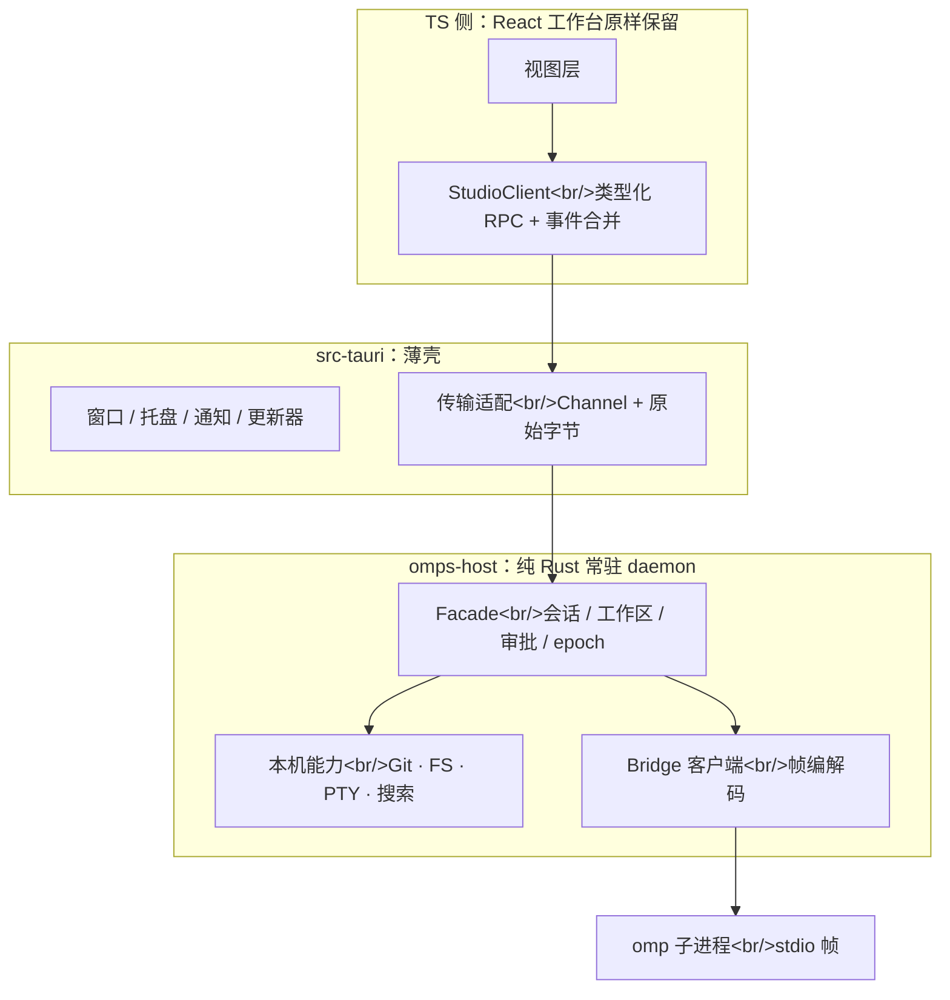

切换到 “Step Studio” 并采用 Rust + TS 的核心价值，不在于简单地“不用 WebView”，而在于利用 Rust 重构进程模型和性能热点。如果只是把 Electron 的壳换成 Tauri，但保留“每个会话一个 omp 子进程”的设计，高开销问题依然存在。
🎯 先瞄准真正的开销来源，而不是框架本身
OMP Studio 在 Electron 下的沉重感，主要来自两个结构性问题：
① 每个对话都是一个独立的 omp --mode=rpc 子进程。开 N 个对话就有 N 个进程在同时运行、收发 JSONL 消息。Rust 版本的首要任务应该是用 Tokio 实现会话多路复用，让一个 Rust 宿主进程管理多个 RPC 连接，而不是为每个会话派生独立进程。
② 终端是“全栈 Web 模拟”。xterm.js 即使开启 WebGL，处理一次密集全屏更新仍需 5.1 ms CPU，而原生 Rust 渲染器可降至 1.1 ms（快 4.6 倍）。终端输出本质是字符网格，用完整 Web 引擎去渲染是巨大的过度开销。
🧭 框架选型：Tauri 是务实起点，但必须做“单 WebView”改造
对于 Rust + TS 的双栈目标，Tauri 2 是唯一能保留 TS 前端生态的成熟选择。预期收益是真实的：安装包从 120–150 MB 降到 10–15 MB，空闲内存从 150–300 MB 降到 30–50 MB。
但有一个硬性前提：Tauri 没有 Electron WebContentsView 的等价物，每个窗口只有一个 WebView。你必须把标签页/面板从“主进程管理的独立视图”改为前端 React 组件状态管理。完成这一步，标签页切换延迟可从 ~200 ms 降到 &lt;50 ms，内存从每标签 50–100 MB 收敛到所有标签共享 30–50 MB。如果保留多 WebView 实例，Tauri 的相对优势会大幅收窄。
GPUI 目前不建议作为起点：Zed 维护者已于 2026 年 2 月暂停社区导向的 GPUI 工作，官方 crate 超过 300 天未更新，生态靠 fork 维持。Longbridge 的生产案例表明，用 GPUI 构建非编辑器应用需要先自建 60+ 组件库（gpui-component）。性能上限虽高，但框架稳定性和前期投入不适合作为迁移的第一站。
⚡ 终极端性能：用原生 Rust 替代 xterm.js
这是 Rust 版本相比 Tauri 壳能获得的最大单项收益：
方案 每面板内存 按键延迟 依赖
xterm.js（现状） 30–50 MB 15–30 ms WebKitGTK + JS 回路
原生 Rust 终端 2–5 MB 1–2 ms 无 Web 引擎
推荐组合是 alacritty_terminal（VT 状态机/网格）+ portable-pty（跨平台 PTY），渲染层直接画到 GPU 或 egui 原语上，PTY 输出更新内存网格，按键直接写入 PTY fd，完全绕过 JS 和 WebView。代价是会暂时失去 ligature 和 sixel 等 xterm.js 特性，但这些可以后续通过自定义渲染通道补回。如果希望保留 Web 栈但获得 GPU 加速，Wraith 是一个“换 import 即用”的替代方案，基于 WebGPU，兼容 xterm.js 的 Terminal API。
🔗 架构与 IPC：用 tauri-specta 延续类型安全
OMP Studio 原有的“类型化 Bridge”不变量可以平移：Rust 命令加 #[specta::specta]，自动生成 TS 调用函数和 DTO 类型，Rust 端改字段时前端 TS 直接编译失败。这比 Electron 的 contextBridge 手动维护类型更可靠。IPC 设计原则是批量传输、避免热路径大 payload，流式 token 更新可以考虑合并为批次事件。
🗺️ 推荐技术栈与分阶段路径
第一阶段（核心目标：降内存、保生态）
```
壳层：Tauri 2
前端：React + TypeScript（复用），标签页改为前端 Zustand/状态机管理
宿主：Rust（tokio 异步运行时）
IPC：tauri-specta（Rust ↔ TS 类型安全绑定）
会话：Rust 侧会话多路复用，替代“每会话一进程”
终端：portable-pty（Rust 侧 PTY） + 前端 xterm.js 或 Wraith（过渡）
```
第二阶段（性能攻坚：终端原生化）
将终端面板替换为 alacritty_terminal + portable-pty + GPU/egui 原生渲染，每面板内存进入 2–5 MB 量级，按键延迟进入 1–2 ms 量级。如果后续 GPU 渲染成为瓶颈，再评估将高频视图逐步下移到 GPUI/egui 混合架构，而非全量重写。
一句话总结：用 Tauri 2 单 WebView 收敛渲染进程，用 Rust 会话多路复用消除进程爆炸，用 alacritty_terminal 原生终端砍掉 Web 栈在字符网格上的过度开销——三步下来，开销的大头基本就被拆掉了。
是的，你说得完全对。Tauri 确实使用 WebView，这是它架构中不可回避的事实。上一轮回答如果让你觉得“换了 Tauri 就没有 WebView 了”，那是我表述不够清晰。
但“都用 WebView”不等于“性能表现一样”，差异的根源在于谁在管理 WebView、同时存在多少个 WebView 实例，以及后端运行时是什么。
🎯 性能差异的真正来源：不是 WebView 本身，是“谁在跑、跑几个”
OMP Studio 在 Electron 下的痛苦，核心不在于“有一个 WebView 在渲染 UI”，而在于多进程 Chromium 模型：每个标签页或视图如果对应一个独立的 WebContentsView，就会派生一个独立的 Chromium renderer 进程，每个进程起步 50–100 MB。AgentMux 的迁移文档明确记录了这一点：Electron 下“每个 tab = 独立 renderer process（约 50–100 MB）”，而迁移到 Tauri 后改为单一 WebView 内的前端标签页切换，内存变为“所有标签页共享约 30–50 MB 总量”，切换延迟从 ~200ms 降到 &lt;50ms。
换句话说，Tauri 的收益来自“把 N 个 WebView 收敛为 1 个 WebView”这件事本身，而不是“用了 Tauri 就自动变快”。如果你把 Electron 的多 WebContentsView 模型原样平移到 Tauri——每个标签页仍然开一个独立的 WebviewWindow——内存照样会涨，只是每个窗口的基础开销比 Electron 略低而已。
⚠️ Tauri WebView 的真实代价：必须诚实地计入
① Windows 上 WebView2 的初始化是硬开销。 WebView2 需要运行时发现、版本握手、UDF 初始化等一系列步骤，冷启动额外延迟 2–3 秒是 Windows 上的已知约束（tauri#10822）。在 AgentMux 的实测中，Tauri（WebView2）启动到 sidecar 就绪为 548 ms，而捆绑 CEF 的方案为 152 ms，CEF 快 3.6 倍。如果你的目标包含 Windows 桌面端，“WebView 初始化慢”这一点无法通过换框架消除，只能通过 UI 策略（骨架屏、延迟初始化）来掩盖体感。
② 多 WebView 实例仍然会显著推高内存。 一个反面但重要的数据点来自 Cap 的基准测试：在 macOS M4 Max 上进行 2560×1440 视频播放负载时，Tauri 的内存（3,724 MiB）反而显著高于 Electron（1,035 MiB），CPU 占用也更高（76.6% vs 53.2%）。这说明在重图形/视频负载下，Tauri 的 WebView 路径并不天然优于 Electron 的 Chromium，性能高度依赖具体工作负载和 WebView 引擎的实现。
③ 多窗口的内存增长是真实的，只是幅度不同。 Tauri 单窗口空闲内存约 20–80 MB，6 窗口约 170 MB；Electron 对应为 100–300 MB 和约 400 MB。Tauri 的“新窗口只增加 DOM/JS 堆内存约 10–30 MB”的前提是共享同一个 WebView 环境，而不是每个窗口创建独立的 WebView 实例。
④ 跨平台 WebView 差异是持续性成本。 Windows（WebView2/Edge）、macOS（WKWebView/Safari）、Linux（WebKitGTK）行为不一致，需要三端分别验证渲染和性能，这不是一次性迁移成本，而是长期维护成本。
💎 对你而言的实际结论
Tauri 给你的不是“没有 WebView”，而是把 Electron 的“N 个 Chromium renderer”替换为“1 个系统 WebView + Rust 后端” 的机会。OMP Studio 如果能在迁移时把标签页、面板、终端都收敛到单一 WebView 内的前端组件树，那么收益是真实的——内存从“每标签页 50–100 MB”降到“总量 30–50 MB”量级，这个判断在 AgentMux 的案例中有直接数据支撑。
但如果你因为某些功能需要（比如终端隔离、重型插件沙箱）而决定保留多 WebView 实例，那么 Tauri 相对 Electron 的优势会大幅收窄，甚至在某些重负载下（如上面的视频场景）可能没有优势。Tauri 是“少开 WebView 才省资源”的框架，不是“WebView 本身免费”的魔法。
从 step-studio（原版通常基于 Electron 三进程架构）迁移并构建你自己的 Step Studio（Rust + TypeScript 架构），方向非常精准。
在动手设计架构前，首先需要校准一个关键的技术认知：Electron 之所以内存占用高、开销大、启动慢，并不是因为它“使用了系统的 WebView”，恰恰相反，是因为它“不使用系统 WebView”，而是为每个应用硬塞了一整套完整的 Chromium 浏览器内核 + 完整的 Node.js 运行时。这导致哪怕是一个空窗口，也会拉起主进程、GPU 进程、多个渲染进程和实用工具进程，起步吃掉 150MB 至 300MB 内存，安装包体积动辄 100MB 以上。
当你决定切换到 Rust + TypeScript 技术栈时，围绕“如何处理 UI 渲染层与 Agent 运行时”，有三条截然不同的架构演进路线，以及一系列决定成败的性能拐点。
一、 三条核心架构路线选型
在立项阶段，你需要先根据 对 step-studio 现有 TS 前端代码的复用诉求 与 极致性能目标 做出路线抉择：
| 架构路线 | 核心技术组合 | 内存与体积表现 | 核心优势与适用场景 |
|---|---|---|---|
| 路线 1：系统级瘦身（最推荐）
Rust 宿主内核 + OS 原生 WebView | Tauri v2 (Rust) + React / SolidJS (TS) | 安装包 3MB–8MB
空载内存 40MB–80MB | 砍掉捆绑的 Chromium 与 Node.js，直接调用系统原生 WebView（Windows WebView2 / Linux WebKitGTK / macOS WKWebView），可最大化复用 step-studio 现有的 TS 界面代码，同时将重 I/O、Git、终端全部下沉至 Rust。 |
| 路线 2：零壳常驻架构
Rust 本地守护进程 + 浏览器工作台 | Rust (Axum + Tokio) + Vite TS SPA / PWA | 服务端仅 15MB–30MB
额外浏览器内核开销为 0 | 这正是 Zeta (Work Studio) 和 OpenCode 采用的路线。不打包任何桌面 WebView 壳，Rust 作为后台极轻量 Daemon 运行，界面直接复用用户本就打开的主力浏览器（支持 --app 独立窗口模式）。 |
| 路线 3：彻底去 WebView 化
Rust 原生 GPU 渲染 + 嵌入式 TS 运行时 | Zed gpui / Iced (Rust UI) + deno_core / Bun Sidecar (TS) | 安装包 15MB–25MB
120FPS 极速帧率，无 DOM 开销 | 彻底抛弃 HTML/CSS/DOM 树（参考 Zed 编辑器），UI 由 Rust 直接通过 GPU 栅格化绘制；TypeScript 仅作为无头（Headless）的 Agent 工具编排层与插件脚本引擎运行。开发成本最高，需重写全部 UI。 |
> 实战建议：如果你想保留 TypeScript 极高的 UI 开发效率，同时根治 Electron 的臃肿，最佳方案是 “路线 1 + 路线 2 同源双模架构”——用 Rust 构建统一的后端核心（Core Host），同时暴露 Tauri v2 IPC 接口与 Axum 本地 WebSocket/REST 网关。这样同一套 TS 前端既能打包成几兆大小的原生 Tauri 桌面端，又能通过 step-studio serve 在远程服务器或本地浏览器中零开销运行。
>
二、 迁移中的五大重点、难点与避坑指南
1. 最大的误区：换了 Rust 底座，为什么长会话界面还是卡？
* 原因剖析：Tauri 替你省下的是 Node.js 和独立 Chromium 的基础进程开销。但在 Agent 工作台中，一个活跃 Session 往往包含上千条流式消息、几十个展开的代码 Diff 块、长篇思维链（Thinking Blocks）和终端输出。如果直接把这些塞进 React 状态树和 DOM 树，WebView 内部的 JS Heap（堆内存）和 DOM 节点重排依然会把内存撑到 1GB 以上并导致输入掉帧。
* 解决方案：
* 计算全部下沉至 Rust：禁止在前端 TS 里跑大文件 Diff 算法、全文正则搜索、大体积 JSON 解析或复杂的 Markdown AST 转换。Rust 算好增量结构后，前端只做纯视图投影（Dumb View Projection）。
* 窗口化转录分页（Windowed Transcript Pagination）：对话流必须采用虚拟滚动（Virtual List），且后端 SQLite 按滑动窗口分页加载历史对话，滑出视口外的重型代码块立即卸载 DOM。
* 编辑器实例池化（Editor Pooling）：Diff 审查面板与代码块切勿为每条消息实例化一个 Monaco Editor（单个实例消耗数千个 DOM 节点与数十 MB 内存），应改用只读高亮 HTML 渲染，仅在用户点击“编辑”时挂载单个共享的轻量编辑器实例。
2. 高频流式通信瓶颈（IPC 序列化陷阱）
* 原因剖析：Step Studio 有两路极高频的数据流——PTY 伪终端的实时字节流和 LLM 流式输出 / 工具刷屏日志。如果在 Tauri 中使用默认的 invoke 或 Event 广播 JSON 字符串，每秒数百次的 serde_json 序列化与跨进程反序列化会瞬间占满 CPU。
* 解决方案：
* 使用二进制流通道：在 Tauri v2 中必须使用 tauri::ipc::Channel 配合原始字节流（tauri::ipc::InvokeBody::Raw / 前端 Uint8Array ArrayBuffer）传输 PTY 终端数据和长文本流。
* 背压与帧合并（Frame Coalescing）：在 Rust 侧设置 16ms（对应 60fps）的环形缓冲区（Ring Buffer），将子进程在 16ms 内喷出的零碎输出合并为单个二进制帧再推送给 TS 渲染层，彻底消除高频渲染抖动。
3. 跨平台系统 WebView 的分裂（尤其是 Linux 与 Windows）
* 原因剖析：Electron 处处皆 Chromium；而使用系统 WebView 时，Windows 是 WebView2（基于 Edge Chromium，兼容性极佳），macOS 是 WKWebView（Safari WebKit 内核），Linux 则是 WebKitGTK。在 Linux 不同发行版与 Wayland 环境下，WebKitGTK 的 GPU 合成器有时会出现闪烁、字体发虚或滚动掉帧。
* 解决方案：
* 严禁使用仅最新 Chromium 才支持的实验性 CSS 特性。
* 在 Linux 启动入口（Rust main.rs）针对特定显卡驱动预置 WEBKIT_DISABLE_DMABUF_RENDERER=1 等环境变量探测与自动降级开关。
4. 子进程生命周期失控与 Windows“弹黑框”问题
* 原因剖析：Agent 会频繁调用 git、rg、bun/node、LSP 服务和 MCP 子进程。在 Electron 或普通 Rust 实现中，如果主程序崩溃退出，后台往往残留一堆僵尸 Agent 进程；而在 Windows 下每次 Agent 调工具还会闪出黑色的 cmd/conhost 窗口。
* 解决方案：
* 静默子进程：Rust 侧所有 std::process::Command / tokio::process::Command 在 Windows 平台必须统一封装，强制附带 .creation_flags(0x08000000)（即 CREATE_NO_WINDOW）。
* 进程树强绑定：Windows 下使用 windows-sys 创建 Job Object（开启 JOB_OBJECT_LIMIT_KILL_ON_JOB_CLOSE），Linux 下设置进程组与 prctl(PR_SET_PDEATHSIG, SIGKILL)，确保 Studio 窗口关闭或崩溃时，所有派生的 MCP、PTY 和 Agent 子进程由操作系统内核瞬间清理。
5. Rust 与现有 TS Agent 生态的融合边界
* 原因剖析：OMP 或主流 Agent 生态有大量基于 TypeScript 编写的 SDK、MCP Client 和自定义插件。如果为了性能把所有上层 Agent 提示词编排、OAuth 登录流和第三方插件全部用 Rust 重写，开发周期会拉长数倍。
* 解决方案：
* 系统底座归 Rust，动态扩展归 TS：文件读写、补丁应用（Patch）、AST 解析、终端 PTY、Git 树、本地数据库全部用 Rust 写成原生模块；对于必须运行 TS 插件或复用现有 OMP 运行时的部分，可以通过 napi-rs 将 Rust 能力暴露给极轻量的 Bun 单文件 Sidecar，或者在 Rust 内嵌 deno_core / rquickjs 沙箱执行插件脚本。
三、 推荐的四层技术架构设计
推荐采用 “Rust 原生重核 + 端到端类型契约 + 极薄 TS 响应式视图” 的四层架构：
* Layer 1：Rust 原生基础设施层（crates/studio-native）
* 直接接管操作系统资源：负责文件树监听、Git 状态与行级 Diff 计算、工作区毫秒级搜索、PTY 终端池管理、SQLite 会话树持久化。
* Layer 2：Agent 编排与运行时层（crates/studio-runtime + 可选 TS Sidecar）
* 管理 Session 状态机、工具审批网关（Approval Gate）、MCP 协议连接池、子代理（Subagents）路由与消息队列。
* Layer 3：统一宿主契约与双模传输层（crates/studio-host）
* 定義唯一的 Query / Command / EventStream 契约，通过宏自动生成 TypeScript 类型签名。对桌面端走 Tauri v2 二进制 IPC，对 Web 端走 Axum WebSocket。
* Layer 4：轻量级 TS 工作台渲染层（apps/workbench）
* 只负责面板布局持久化、虚拟化会话流渲染、快捷键分发和用户交互收集。
四、 推荐的高性能、低开销开源组件清单（基础设置参考）
在搭建项目脚手架时，用以下经过生产验证的高性能组件替代传统臃肿方案，可以直接将内存和延迟压到最低：
1. Rust 后端核心库（Cargo Workspace）
| 功能模块 | 推荐开源 Crate | 为什么选它（性能与架构收益） |
|---|---|---|
| 桌面容器与 IPC | tauri (v2) | 相比 v1 重构了 IPC 架构，支持 Raw Binary Payload 与多窗口精细权限隔离，内存占用极低。 |
| 异步运行时与网关 | tokio + axum | 零成本抽象的异步运行时；若开启本地 Web 模式或远程挂接（Attach），axum 的 WebSocket 吞吐量极高且占用极小。 |
| Rust ↔ TS 类型同步 | specta + tauri-specta（或 ts-rs） | 在 Rust 的 struct 和命令函数上加一行宏，编译时自动生成前端 .ts 接口与调用函数，彻底告别手写类型对齐。 |
| 跨平台 PTY 伪终端 | portable-pty（或 alacritty_terminal） | portable-pty 出自 WezTerm 作者，完美处理 Windows ConPTY 与 Unix PTY 差异；若想把终端网格解析也放在 Rust 侧以减轻前端压力，可搭配 alacritty_terminal。 |
| 极速文件搜索与遍历 | ignore + grep-searcher | ripgrep 的核心底层库，原生支持 .gitignore 过滤与多线程 SIMD 搜索，比 Node.js 遍历快一个数量级。 |
| Git 状态与 Diff 引擎 | gix (gitoxide) + similar | gix 是纯 Rust 实现的高性能 Git 库（无需外部调用 git CLI 进程即可秒读分支与状态）；similar 是极快的 Rust Diff 算法库，直接在后端产出结构化行级 Diff。 |
| 代码 AST 与语法分析 | tree-sitter | 原生 C/Rust 绑定，毫秒级增量构建代码语法树，用于给 Agent 提供精准的代码符号大纲（Outline）与上下文切片。 |
| 文件系统实时监听 | notify (notify-debouncer-full) | 跨平台内核级文件事件监听（inotify / ReadDirectoryChangesW），自带防抖合并，避免 Agent 批量改文件时冲垮前端刷新。 |
| 本地数据库与检索 | rusqlite (开启 bundled + WAL + FTS5) | 抛弃缓慢且容易损坏的本地 .json 会话文件。用单文件 SQLite 配合 FTS5 全文索引存储成千上万条 Session 记录，查询延迟低于 1 毫秒。 |
2. TypeScript 前端渲染层（推荐 Bun 作为包管理与构建工具）
| 功能模块 | 推荐开源组件 / 框架 | 为什么选它（对比传统 Electron 常见重型组件的收益） |
|---|---|---|
| UI 视图框架 | SolidJS（极致性能首选）
或 React 19（生态复用首选） | 若从零写 UI，SolidJS 无虚拟 DOM、基于细粒度信号（Signals）更新，在高频流式 Token 输出场景下 CPU 与内存开销比 React 低 30%–50%；若想直接移植 step-studio 现有组件，则用 React 19 并开启 React Compiler。 |
| 轻量状态管理 | Zustand 或 Nanostores | 极简、无冗余 Context 重渲染开销，非常适合通过外部 WebSocket / IPC 流直接驱动外部 Store 更新。 |
| 代码编辑器与 Diff | CodeMirror 6
（替代 Monaco Editor） | 关键减负点：VS Code 的 Monaco Editor 体积庞大且极吃内存；CodeMirror 6 采用高度模块化架构，内存占用不到 Monaco 的 1/5，且对大文件虚拟滚动和自定义 Agent 行内批注（Inline Widget）支持极佳。 |
| 代码语法高亮 | Shiki (Web Worker / 细粒度 Engine) | 使用基于 JavaScript RegExp 引擎的 shiki/core（无需加载庞大的 Oniguruma WASM）并放在 Web Worker 中异步高亮，主线程零阻塞。 |
| 长对话流虚拟列表 | TanStack Virtual (@tanstack/virtual-core) | 无头（Headless）虚拟滚动引擎，支持动态高度测量，确保 10,000 条 Agent 工具调用消息在 DOM 中只保持约 15–20 个活跃节点。 |
| 可拖拽多面板布局 | Dockview 或 react-resizable-panels | Dockview 零依赖、原生支持类似 IDE 的分屏、标签页拖拽停靠、浮动面板与布局 JSON 序列化持久化，比传统 GoldenLayout 轻量得多。 |
| 前端终端渲染 | @xterm/xterm + @xterm/addon-webgl | 务必开启 WebGL 渲染插件，将终端字符矩阵绘制完全卸载到 GPU，并通过二进制流直接喂入 xterm.write(uint8Array)。 |
五、 推荐的工程目录初始化结构（Monorepo 模板）
建议采用 Cargo Workspace + Bun Workspace 混合 Monorepo 结构，严格强制“前端不碰系统 API，后端不耦合具体 UI”：
step-studio/
├── Cargo.toml                 # Rust Workspace 根配置
├── package.json               # Bun Workspace 根配置
├── crates/
│   ├── studio-protocol/       # 核心数据结构与契约（通过 specta 自动导出 bindings.ts）
│   ├── studio-core/           # 纯 Rust 核心：Git(gix)、Diff(similar)、Search(ignore)、PTY、SQLite
│   ├── studio-host/           # 统一宿主服务层（管理 Session 生命周期、MCP 与 Agent 进程）
│   └── studio-tauri/          # Tauri v2 桌面壳入口（薄薄一层，将 studio-host 桥接为 IPC）
└── apps/
└── workbench/             # Vite + TS 前端（只依赖自动生成的 bindings.ts 与流式客户端）
├── src/
│   ├── bridge/        # 自动适配 Tauri IPC 或 WebSocket 的统一传输层
│   ├── stores/        # 按 Session ID 隔离的细粒度状态树与环形缓冲接收器
│   ├── panels/        # Explorer / Diff / Terminal / AgentHub 面板
│   └── composer/      # 多模态输入框、模式切换与内联审批卡片
通过下方交互式架构权衡对比器，你可以调整对内存占用、冷启动速度、包体积、TS 生态复用度及高频流渲染稳定性的权重偏好，直观对比各套 Rust + TS 架构方案的综合得分与资源指标：
如果你想直观了解如何用 Tauri 2.0 结合 Rust 与前端技术栈构建超轻量级的生产级桌面应用以替代臃肿的 Electron，可以参考这段 2026 Tauri 2.0 生产级轻量 Rust 桌面应用构建实战，视频详细演示了如何将重负载逻辑下沉至 Rust 并大幅压缩应用体积与内存开销。
上图是我推荐的分层：核心与界面分离，`step` 保持外部子进程。我按这个理解来答：「Step CLI」就是阶跃的 Step Code（命令 `step`），它是 Pi 的衍生版，TypeScript 写的 pnpm monorepo，目前是 0.1.x，大约每周一版。所以 Rust 做 Studio 本体，TS 只留在 agent 侧，不进 UI 热路径。如果你想做的是 TUI 版，架构不变，前端换成 ratatui 即可。
**为什么这么拆**
- 界面可重启：核心常驻，GUI 退出或崩溃不影响会话。tty7 就是 GPUI + Alacritty 加守护进程，让会话在退出应用后仍然存活。
- 协议是唯一真源，沿用 OMP Studio 的思路（类型优先、失败关闭、`accepted` ≠ 成功），换 agent 只改适配器。
**接入面（先实测）**
`step -p --mode json` 输出的是 Pi 的 JSON 事件流，OpenAgents 的适配器就是每条消息跑一次 headless 来接的。Pi 本身还有 `--mode rpc`：Rust 写的 pi-acpinator 会 spawn 常驻的 `pi --mode rpc`，再翻译成 ACP，并用有界通道做背压，值得照抄。`step` 是否保留 rpc 模式我没查到，先跑 `step --help` 确认。ACP 官方有 Rust SDK，做 ACP 适配器成本不高。
**技术栈**
- GUI：GPUI + gpui-component。它自带 Dock 布局、Markdown 和 Tree-sitter 编辑器（20 万行仍稳定），Longbridge Pro 已在商用。Windows 后端随 Zed 稳定版已上线（DX11），但外部项目要依赖 Longbridge 的周更快照或直接 git 依赖 Zed，API 会变，要锁版本。备选 Slint（更轻）和 egui（原型最快）；Xilem、Dioxus Native 仍偏实验。
- TUI：ratatui（即时模式，只写变化的单元格）。想留在 TS 就用 OpenTUI，它是 Zig 核心 + Bun FFI，去掉了 Ink 的 32 FPS 上限，但要求 Bun。
- 终端面板：`gpui-terminal` 基于 alacritty_terminal，可配 portable-pty，别自己写 VT。
- 协议：serde + schemars 导出 JSON Schema，再生成 TS 类型，让 Rust 当唯一真源。
- 存储：SQLite 只放索引和用量，会话文件以 `step` 自己的为准，不复制。
- Git：读用 gix，写操作（push/rebase）直接调系统 git 更稳。
**重点难点**
1. 内存别指望只靠换框架。一份社区单人测试（macOS，10 万行列表）里，Slint、egui、GPUI 峰值内存都在约 118–126 MiB，Qt 约 215 MiB。原生 GPU 框架自己的基线就是这个量级，该测试也没含 Tauri/Electron。真正省内存靠设计：虚拟化对话列表、流式 Markdown 只重解析最后一块、工具输出截断并按需加载、delta 合并到每帧一次。
2. 协议不稳：要固定最低版本，做能力探测，再用录制回放的 mock `step` 做契约测试。OpenAgents 就是这么做的，并把支持下限定在 0.1.4。
3. 重名与隔离：Smallstep 的证书工具也叫 `step`，要靠安装目录和 `--version` 格式识别；`~/.stepcode/auth.json` 里的凭据优先于 `STEP_API_KEY`，想隔离得设私有的 `STEP_CODING_AGENT_DIR`。
4. 进程树：Stop 必须杀整棵树。光发 SIGTERM 会漏掉还在握手的 MCP 服务器，Windows 要用 `taskkill /T /F`。另外 `/goal`、`/cron` 要求 step 进程一直在，所以 host 要当 supervisor，GUI 退出别带走它。
5. 审批要自己做：headless 给不了 Full Access 所需的一次性风险确认，会降级成 Approve for Me，而且 三档权限也不是系统沙箱。Studio 要自带审批 UI（pi-acpinator 的做法是用内置扩展拦截工具确认），再配 worktree 或容器隔离。
6. Prompt cache：官方修过一个坑：进计划模式时工具顺序变了，整段对话的缓存失效。UI 里切 plan 或角色要走会话内命令（OpenAgents 发的是 `/plan`，CLI 自己处理，不经过模型），别重建前缀。
7. 安全面：CLI 会把环境变量传给它执行的 shell 命令，`env` 就能看到 key，所有帧和日志要按值脱敏。遥测默认开启，可在 `~/.stepcode/config.toml` 里关；官方二进制只走 CDN，GitHub 没有 release，要可审计就从源码构建（Node ≥ 22.19）。
8. 原生自绘的隐性成本：IME、选择/复制、字体回退、无障碍都得自己兜，中文输入法要最早测。Windows 上 官方推荐用 WSL，PowerShell 安装还是 beta，所以要支持经 `wsl.exe` 启动 step 并做路径映射。
**落地顺序**
先写无界面的 `studio-core`，把 `step` 的事件录下来当测试夹具。再接最小前端：对话流、审批、停止。最后加 Git、终端和 Agent Hub 面板。
需要的话，我可以接着给出 studio-protocol 的最小 schema（会话、事件、审批、epoch），或者把 `step` 事件映射成 UI 状态机。
已完成网页搜索
### **先纠正一个前提：Electron 并不使用系统 WebView**
这个判断正好说反了。Electron 自带一整套 Chromium 多进程运行时，打包进安装包；Tauri 才渲染在系统 WebView 里，Windows 用 WebView2，macOS 用 WKWebView，Linux 用 WebKitGTK。因此换成 Rust + TS 后省下的是“打包一份 Chromium”的固定成本，而不是“WebView 本身太重”的成本。
收益需重新估算。你们的工作台是重 React UI，包含大列表、diff、终端和 markdown 流式渲染；主要内存开销来自 UI 复杂度本身，这部分换成 Tauri 后依然存在。合理预期是：空闲 RSS 从 250\~500MB 降到 120\~200MB，冷启动从 2\~3 秒降到 0.6\~1.2 秒，安装包从 100MB+ 降到 40MB 级，不含 WebView2 运行时。如果目标是 50MB 级，就必须放弃 Web 技术栈，改走原生 UI，那是另一个项目量级。
另外，Linux 是这套方案唯一的明显短板：WebKitGTK 的 JS 引擎与渲染一致性明显弱于 Chromium，NVIDIA + DMA-BUF 还有已知的渲染黑屏问题，需要 `WEBKIT_DISABLE_DMABUF_RENDERER=1` 兜底。你们现在的 README 里，Linux 本来也只是试验性的 AppImage；Rust 版建议把 Linux 明确标成“社区支持、不做承诺”，不要为了它拖慢主线。
以下把 step studio 理解为你们的 Rust + TS 新版代号。
### **三个必须先确定的结构性决策**
**决策一：不要把业务逻辑写在 `#[tauri::command]` 里。** 这是迁移里最容易犯、也最难回头的错误。Tauri 只当窗口 + 传输 + 打包的适配层；所有能力实现放在一个独立的纯 Rust crate（`omps-host`）里，不依赖任何 GUI 库。这样它可以单独启动成 daemon、可以用 CLI 冒烟测试、可以 headless 跑 CI，将来想换 gpui 或 egui 也不用重写 core。
**决策二：把 host 做成独立进程，而不是 in-process。** 你们现有设计里，“关窗后任务继续跑”依赖托盘存活；到了 Rust 侧，崩溃语义完全不同：Electron 渲染进程挂了还能重载，Rust 主进程一 panic 整个应用就没了，omp 子进程也一起完蛋（除非你做了 Job Object）。正确做法是：`omps-host` 是 detached 的常驻进程，桌面 app 只是客户端。这一条同时解决三件事：崩溃隔离、托盘模式下的任务保活、多窗口 / CLI 附着调试。
**决策三：协议是唯一可保留的真源。** `omp --mode studio-host` 那套 Studio Bridge 协议不用改，Rust 只需重新实现它的客户端。反过来说，`omp-patch/overlay` 和四组接缝补丁不要以为换壳就能删，那层是 runtime 侧能力，与外壳无关。把它和 UI 重写分开排期，否则你会同时踩两个雷。
### **推荐架构**

TS 侧只认语义 command 和事件流，拿不到 token、进程句柄和绝对路径；这和你们现在的“不变量”完全同构，属于平滑平移。Rust 侧的 facade 负责维持那三条规则：未知 mutation 失败关闭、`accepted ≠ 成功`、Runtime 丢失封 epoch 并把未完成项标 `outcome_unknown`。
### **技术栈选型**
| 层 | 推荐 | 说明 |
|---|---|---|
| 外壳 | Tauri 2.12 | 比 2.0 在 IPC 与 WebView 管理上成熟得多；2.12 已放弃 Win7，MSRV 抬高，依赖链更干净 |
| 命令绑定 | tauri-specta | 从 Rust command 生成类型化 TS 客户端，省掉手写 `invoke` 字符串 |
| 领域类型 | ts-rs | `#[derive(TS)]` 直接导出 `.d.ts`，替换现在手写的 `packages/studio-protocol` |
| 异步 / IO | tokio（bounded mpsc、watch、broadcast） | 背压的基础设施全靠它 |
| PTY | portable-pty | wezterm 出品，跨平台最稳，比 `pty-process` 完整 |
| VT 解析 | vte / termwiz | 见下文“终端”一条的取舍 |
| Git | gix 读 + git CLI 写 | libgit2 在 worktree、sparse-checkout、partial clone 上坑多，写路径用 CLI 更可靠 |
| 文件监听 | notify + notify-debouncer-full | 必须 debounce，否则 build 一下事件风暴 |
| 全文搜索 | ignore + grep-searcher | 就是 ripgrep 内核，直接拿来当库用，别自己写 walker |
| 存储 | rusqlite（WAL） | 会话索引、用量统计、搜索缓存；单文件、可 VACUUM |
| 签名校验 | ed25519-dalek | 和现成的工件校验对齐；更新器同样走 Ed25519/minisign |
| 可观测性 | tracing + tracing-subscriber | 结构化日志 + span，比 `println!` 强一个量级 |
| 前端 | React + Vite，编辑器换 CodeMirror 6 | Monaco 是 Electron 时代体积和内存的大头，CM6 轻一个档 |
### **六个真正的难点**
**1. 高频事件必须自己做合并，Tauri 不会帮你。** Tauri 的事件投递本质是“一条事件一次 eval 注入 JS”，既不合批也不限流。token 流、工具调用 delta、PTY 输出、git status 刷新叠在一起，页面脚本队列会瞬间堆满，主线程帧时间直接爆掉。正确做法是：Rust 侧按 topic 维护“最新值槽位”（coalescing），普通状态变更用丢旧保新；必达的流式文本用有界 channel + `try_send` 失败即累加，固定 16\~33ms 节奏 flush；TS 侧统一在 `requestAnimationFrame` 里消费。PTY 走高吞吐通道时用二进制载荷（`InvokeBody::Raw` / `Channel&lt;Vec&lt;u8>>`），别每 4KB 走一次 JSON 序列化。
**2. 子进程生命周期是跨平台的三套不同答案。** Windows 必须显式创建 Job Object 并设 `JOB_OBJECT_LIMIT_KILL_ON_JOB_CLOSE`，再把 omp 分配进去，否则应用崩了子进程还在跑（你们 README 里已经用 Job Object 解决了，Rust 侧要重做一遍，用 `windows` crate）。Linux 用 `pre_exec` 里的 `PR_SET_PDEATHSIG`，再加父 pid 校验兜住 race。macOS 没有等价机制，业界通用技巧是让子进程监视 stdin，父进程一死 EOF 就自退，这需要包一层极薄的 launcher。三个平台三条路径，测试成本别低估。
**3. IPC 不是安全边界，别指望 Tauri ACL 顶住。** Tauri 2 的 capability 只能做到 command 粒度授权，做不到“这个字段不能回传”“这个 id 必须不透明”。你们现有的渲染层最小权限、epoch 封禁、`accepted` 语义，全部要在自己的 facade 里实现。特别强调：Bridge token 只存在于 host 进程内，注入子进程环境变量，任何情况下不进入 WebView 上下文。
**4. 终端是最容易做砸的一块。** 方案 A：xterm.js + WebGL addon，几乎零改动，但每个字节都要过 IPC，且在 WebKitGTK 上 WebGL 支持差、在 WKWebView 上 canvas 合成有额外开销。方案 B：Rust 侧用 termwiz/vte 维护屏幕状态，只推 damage 差分给自绘渲染，IPC 量降一两个数量级，但等于重写终端渲染。建议先走 A，把 PTY 读取侧做成 Rust 侧限速 + 批量，等真的有吞吐瓶颈再考虑 B，不要一开始就赌。
**5. 逐行暂存（stage hunk）比想象中难。** 这块不能用 gix 的空 API 解决，要自己构造 patch 再 `git apply --cached`。必须处理：CRLF / `core.autocrlf`、文件模式位、二进制文件、末尾无换行、重命名、以及 patch 期间工作区被 agent 改动导致的 apply 失败。失败要能回滚到干净索引态并给出可读错误，否则用户会看到“点了暂存但什么都没发生”。
**6. Rust 的崩溃语义会改变你的运维模型。** panic 默认直接终止进程，没有“渲染进程崩了只重载页面”这种缓冲。三件事必做：`std::panic::set_hook` 记录到崩溃日志；在 command 边界用 `catch_unwind` 兜住可恢复的 panic 并转成结构化错误返回；外面套一个 supervisor，host 异常退出时自动重启并让 UI 走“重连 + 全量刷新”而不是继续用陈旧状态。
### **迁移路线：先把架构收益拿到，再换壳**
第一阶段不要动 UI。把协议抽出来，用 Rust 写 `omps-host`，做成一个能独立跑的 CLI（`omps-host --connect &lt;socket>`），用一个最简终端客户端把会话列表、发消息、看事件流跑通。这一步只写 Rust，风险可控，而且它同时是未来所有测试的基座。
第二阶段换壳：Tauri 包装现有 React 工作台，webview 差异集中适配（WKWebView 的 API 缺失、WebView2 运行时检测、WebKitGTK 的渲染开关、输入法在 WebKit 系上的历史 bug、高 DPI 下字体渲染偏移）。这一阶段目标是“功能等价”，不做任何优化。
第三阶段把热路径下沉到 Rust：git status、项目搜索、文件树懒加载、PTY、用量聚合。每个下沉都要有前后可测的指标，否则容易变成主观重构。
第四阶段做体积与启动优化、更新器接入、崩溃上报，然后才是可选的第五阶段：局部原生 UI 试点。
### **几个反直觉的提醒**
不要用 `libgit2`/`git2` 当唯一 Git 后端；不要用 `serde_json` 序列化热路径上的大对象；不要在 Rust 里 `spawn_blocking` 里做重 CPU 又频繁调用的活；不要用 `std::fs::read_dir` 递归扫目录做文件树，用 `ignore` 的 walker 并做并发上限；不要低估交叉编译与 CI 矩阵的成本（Windows ARM64 + macOS ARM64 + Linux x64 三套产物，签名和更新通道各自独立）。
还有一个长期选项值得知道：gpui-kit 这类基于 Zed GPUI 引擎的 Rust 组件库已经积累到 75+ 组件，带 DataTable 行列双虚拟化、20 万行稳定的编辑器、Dock 可拖拽布局、diff 查看器，并在长桥证券的桌面客户端里跑过两年生产环境。它和你们的需求形状高度重合，是“真想做到 50MB 级 + 原生手感”时唯一现实的路。代价是生态还偏新、API 演进快、团队要重学一套声明式范式，属于用 6 个月换下一代架构的选择，不适合放进这次迁移里。
验收上建议先定死数字，否则“低开销”会变成无休止的争论：冷启动 &lt; 1.2s、空闲 RSS &lt; 200MB、安装包 &lt; 45MB、10 万行会话滚动稳定 60fps、PTY 满速输出时最长帧 &lt; 16ms。这几个阈值达标，这次重写就算成功；达不到，说明问题在 UI 层而不在壳层，换什么框架都没用。